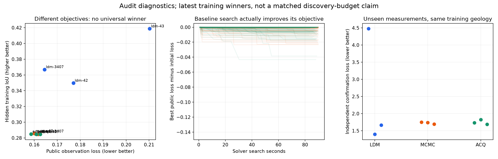
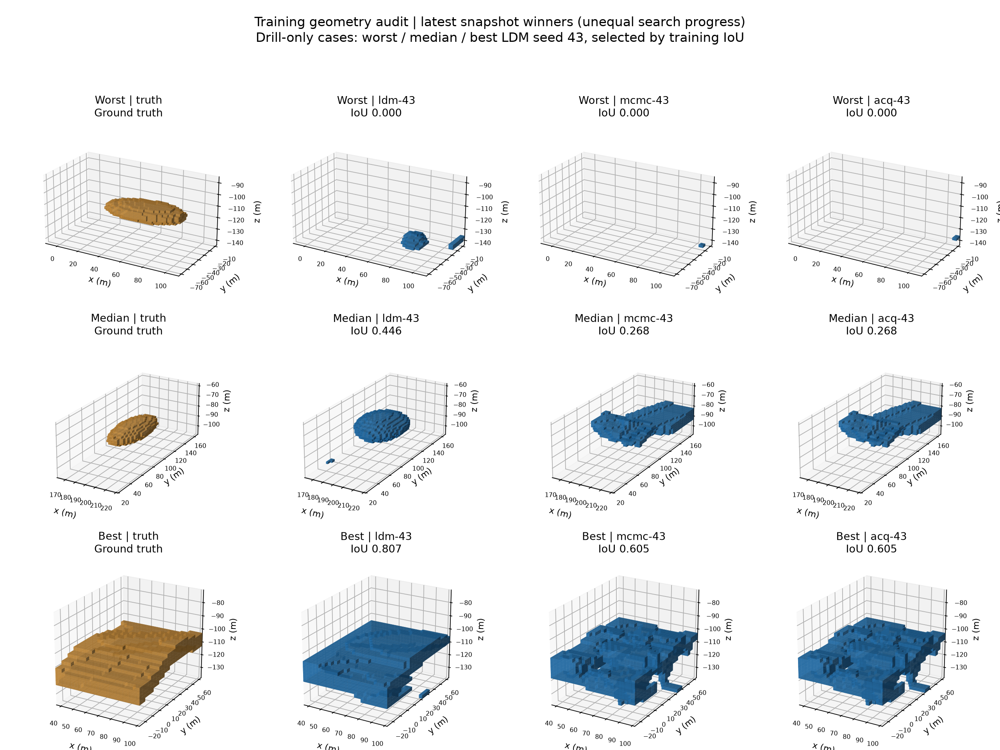
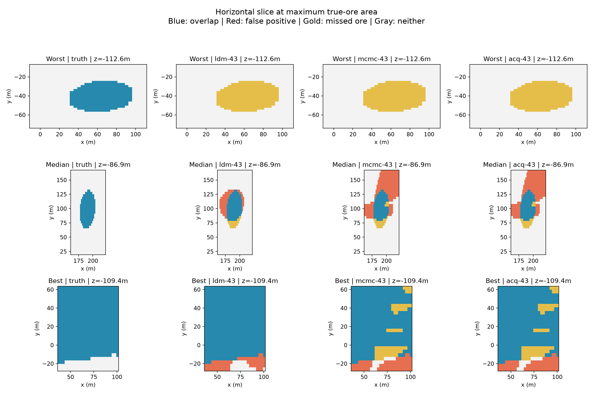

# 铜矿反演算法审计与暂停整改

更新时间：2026-10-24，用户明确要求停止后。**所有铜矿实验保持停止，半小时自动监控已暂停。以下旧结果不能用于声称公平战胜原论文方法。**

## 结论

1. LDM 找到的是快速空间插值/核回归算法，不是在两秒内完成与蒙特卡洛等价的搜索。
2. 确认基线适配存在缺陷：每步把连续水平集二值化，抹掉亚体素位移。已修开发代码并远程回归；旧冻结基线及其结果保留原样。
3. 现有榜单损失是 `1 - 隐藏真值 IoU`，基线内部优化的是观测拟合损失，两者不同。LDM 的几何优势不代表观测拟合优势。
4. 当前正式数据只启用了禁区约束，地质体积、连通性等限制没有启用。现在新增正式发布准入检查：缺少独立地质先验校准证据，或者所有几何先验关闭的数据，不得发布或启动正式实验。
5. 当前证据未发现这三个最佳源码读取隐藏真值、按 case ID 查表、利用场幅值骗分或在禁区输出矿体；这不是完整的安全性证明。主要已确认问题是基线失真、约束不足和结论口径过强。

## 停止范围与数据保留

- 九组搜索/调参控制器、九个训练评分服务及监督器已停止。
- 九组中期验证/测试控制器已停止；相关 40 个运行容器停止，保留文件、账本、模型和已完成收据。
- 另停止五个遗留铜矿评分服务。没有停止其他项目或集群基础设施。
- 中期独立评估按共同 **31 个已收费源** 封存，各组前三名；停止时九组状态均为 `frozen`，只有部分验证工作完成，**测试收据为 0，独立验证选型和测试均未完成**。验证目录的 264 个收据包含接口、作业和 case 等层级，不能当成 264 个完整验证 case。
- 不能将中断作业补记为成功或免费补评。旧训练预算不能重置后继续冒充同一次正式实验。

停止证据：[stop.json](stop.json)。完整诊断：[forensics.json](forensics.json)。原始隐藏数组保留在私有账户，没有导出给研究 agent。

## 最佳算法具体是什么

下表是审计快照中各组最新完整训练结果；各组搜索进度不同，**此表用于解释源码，不是同预算优势比较**。

| 方法/搜索种子 | 主要方法 | 训练 IoU ↑ | 求解秒/case ↓ |
|---|---|---:|---:|
| LDM / 42 | kNN 反距离加权，水平/垂向不同平滑尺度，接触点偏移校正 | 0.3497 | 1.416 |
| LDM / 43 | 各向异性高斯核岭回归；按观测组交叉验证；前五尺度集成；接触点与体积分数阈值混合 | 0.4187 | 3.384 |
| LDM / 3407 | 局部 kriging，8 邻居，各向异性度量，接触点阈值；不适用时回到基础插值路径 | 0.3669 | 1.093 |
| MCMC / 42 | 高斯随机速度场、水平集扰动、Metropolis 接受 | 0.2857 | 91.360 |
| MCMC / 43 | 同上，另一组 Sobol 选出的超参数 | 0.2847 | 91.312 |
| MCMC / 3407 | 同上 | 0.2852 | 91.521 |
| ACQ / 42 | 随机候选池 + 在线 Bayesian ridge 选点 + Metropolis | 0.2850 | 91.276 |
| ACQ / 43 | 同上 | 0.2847 | 91.237 |
| ACQ / 3407 | 同上 | 0.2846 | 91.276 |

所有求解程序限制均为 120 秒/2 CPU/4 GiB。基线代码的主动搜索截止时间为预算的 75%，即约 90 秒；LDM 插值算完就返回。上述秒数不含算法设计/API/验证/排队/恢复成本。先前“约两秒”的 2.32 秒均值来自 31 源预算下的候选，不是当前三个最新候选。

### 已确认：水平集适配抹掉小步移动

原仓库对连续 `model_update` 做 `skfmm.distance(model_update)`，保留零交叉位置。适配代码却调用 `canonicalize`，先做 `field > 0`，再从 ±1 重建距离。即使一个方向上持续微小移动，也可能每次被重置。

远程最小复现：规则平面、每步移动 0.1 体素，10 步后原连续方法改变 144 个体素，二值重建方法改变 0 个。见 [subvoxel-diagnostic.json](subvoxel-diagnostic.json)。

修复：用独立 `search_distance` 校验合法占据区域，但保留连续零交叉的距离场作为搜索状态。评分仍使用同一占据规范化，不能通过缩放场幅值改变分数。回归覆盖小步累积、禁区拒绝和源码稳定性。

此复现证明了机制缺陷，**没有量化该缺陷解释了多少完整实验性能差距**。需要在新版本上用同预算完整重跑，不能把旧差距全部归因于它，也不能假设修复后一定追平 LDM。

## 两种损失给出不同结论

初始最近邻矿体：平均公开观测损失 0.16351，IoU 0.28401。

| 方法/种子 | 公开观测损失 ↓ | 独立确认测量损失 ↓ | 最终仍等于最近邻初始矿体的 case |
|---|---:|---:|---:|
| LDM / 42 | 0.17705 | 4.47565 | 0/48 |
| LDM / 43 | 0.21024 | 1.39523 | 0/48 |
| LDM / 3407 | 0.16447 | 1.66558 | 0/48 |
| MCMC / 42 | 0.16005 | 1.74993 | 18/48 |
| MCMC / 43 | 0.16171 | 1.73728 | 28/48 |
| MCMC / 3407 | 0.16262 | 1.69299 | 34/48 |
| ACQ / 42 | 0.15859 | 1.73571 | 14/48 |
| ACQ / 43 | 0.16091 | 1.82174 | 17/48 |
| ACQ / 3407 | 0.16263 | 1.68575 | 28/48 |

确认测量是在**同一训练地质体**上另采位置/钻孔及噪声，不能代替独立地质体的验证或测试。这里都是简单 case 均值；每个训练父体恰有两个观测包。

基线每 case 平均执行约 19–118 次观测目标评估，ACQ 另生成更多候选；不是空跑。它们确实降低自己的公开目标。LDM 更高的 IoU 反映其空间归纳偏好更适合部分合成地质体，而非普遍更低的数据误差。LDM / 42 的确认测量误差尤其需要警惕。

## 矿体与真值对比

选择规则固定为最新 LDM / 43 的 **drill-only 训练 case 按 IoU 排序的最差、中位、最好**；没有只展示好例子。各行四列依次是真值、LDM、MCMC、ACQ。训练搜索预算不同，图用于形态诊断。

- 最差 case：三种方法 IoU 均为 0，矿体位置明显错误，不能称为成功反演。
- 中位 case：LDM IoU 0.446，相对基线 0.268，更接近主体位置，但仍有体积偏差和孤立小块。
- 最好 case：LDM IoU 0.807，相对基线约 0.605，主体吻合较好，但仍有局部碎片/边界误差。
- 全部训练 case 上，LDM 三个最佳候选最多分别出现 7、6、17 个连通块，基线最多 14–22 个。非活动区正体素数均为 0；这不能替代地质合理性检查。

金色为漏掉的真实矿体，红色为虚构出的矿体，蓝色为重合；剖面高度选择真值横截面积最大的层。3D 图使用原网格体素，不对结果做美化修补。

## 已完成的工程修复

| 问题 | 修复 | 验证 |
|---|---|---|
| 小步水平集位移丢失 | 搜索状态保留连续零交叉，独立评分继续占据规范化 | 远程数值复现及回归 |
| JSON 键序改变源码导致重复收费 | CONFIG 按确定键序写入，JSON 往返源码完全一致 | 两种基线参数序列回归 |
| 同步接口验证阻塞其他分支 provider 授权 | 验证在单工作线程执行，主响应循环继续处理授权；提交顺序保持串行，退出前等待验证写入结束 | 慢验证/授权事件回归及共享 Harness 测试 |
| 并发记账竞争 | BudgetLedger 原子预留和快照加重入锁 | 16 线程重复/超额预留回归 |
| 拒绝消耗槽位后还要求 321 个成功观测 | 选择前重读科学预算；仅当所有收费源有评估或拒绝结局才正常完成；报告区分完整轮和有观测的轮 | 预算/引擎回归 |
| 无地质先验仍可获正式资格 | 发布和启动要求独立开发集校准证据，逐 case 检查至少实际启用一个几何先验 | 拒绝全关闭先验的回归 |

没有更改旧冻结源码、旧镜像、已计费候选或已有评分结果。开发修复在独立远程目录 `/Aidata/shared/ldm/copper-audit-fixes-20261024/source` 测试。

测试日志：[Harness/预算/基线 82 项通过](audit-regression.log)、[早期 v2 84 项通过、2 项跳过](v2-regression.log)、[共享引擎 99 项通过](engine-regression.log)。各测试组有交集，不把数量相加冒充唯一测试数。后续容器验收与最新回归见文末；完整正式科学重跑尚未执行。

## 恢复前必须完成，当前不能算已修完

1. **独立地质先验校准**：在独立开发/校准父体上预先确定形态、碎片尺度、连通性及体积政策；明确哪些是可观测的地质知识。不能从每个测试真值推导限制，不能临时填一个组件数或体积范围就宣称真实。
2. **明确正式结论指标**：保留原始观测目标、独立确认测量误差、IoU/表面距离/体积误差分别报告。当前 IoU 外层目标是显式设计，不是计算错误；它与用户“拟合测量数据”的目标存在口径差异。恢复前应固定主指标和选型规则，不能根据谁获胜而改指标。
3. **完整基线资格验证**：固定依赖镜像和修订后的科学源码摘要，核对原仓库转移逻辑、提案幅度/接受率/有效几何改变率、返回最优状态和时间边界；增加简单插值基线，避免只与被削弱的随机方法比较。
4. **新的版本与预算**：新的科学源码、镜像、数据/先验和协议统一冻结；旧 r1 只作故障诊断，不与新结果拼接。20×16+初始化 321 是收费源上限，接口拒绝仍占预算，不承诺 320 个成功候选。
5. **完整闭环验收后再正式搜索**：只读接口、独立评分、并发排队、拒绝/超时/中断恢复及计费核对全部通过后，再启动九组。训练封存→验证选型→测试的屏障不可省略。当前中期测试未开始；验证的部分运行不能写成完成。

在以上条件满足前，不恢复监控、不启动正式搜索、不发布 LDM 已稳定优于基线的结论。

## 用户确认后的修订与验收进展

用户已明确选择：**独立测量误差为主，IoU 为辅**。这一决定取代上文“主指标待固定”的事项。旧图表仍仅表示旧的 IoU 搜索，不能用新指标重新解释旧优势。

### 主指标、约束与数据版本

- 所有方法内部仍拟合公开测量；私有评分用独立采样的确认测量，调用同一个 `objective.score`，并要求公开/确认数据的地质先验完全相同。
- 主损失为各 case 的 `L/(1+L)`，其中 `L` 是确认测量目标；父体内平均，再按父体等权平均。失败输出记 1；`research_utility = 1 - loss_total`。有界变换是固定的聚合定义，不是原始误差值；原始确认误差保留在私有 case 收据中。
- 训练排序、验证选型和测试聚合统一采用该主损失。IoU 不参与排序。已增加“低测量误差但低 IoU 的候选应胜出”的测试。
- 修订后的合成总体公开先验：可活动区内矿体比例 2%–65%，最多 4 个连通体。2%–65% 沿用原生成总体范围；4 个连通体是新版本明确限定的适用范围，统一作用于所有地质类型和所有方法，不是从每个隐藏真值计算出的答案提示。
- 对应生成质量门和正式发布检查已接通；发布前也检查真实模型确实满足声明先验。不能把旧数据直接改成新正式版本。
- 没有未经验证地加入面积/碎片的软惩罚权重。这个范围仍是受约束的合成任务，不能据此宣称对真实矿区普遍成立。
- 最近邻与随机场初始模型增加公开先验下的合法构造；只读接口增加实际体积/连通性约束样例。所有候选仍由独立评分器检查，不能由自己的 repair 函数自证合法。

### 独立开发校准

使用 10 个预先指定的新开发父体，覆盖 folded、lens、multiple、faulted、faulted_lens 五类，各两个种子。没有读取评估集真值、没有调阈值或替换科学失败样本。18 个数值检查覆盖空体/全体拒绝、初始化合法性、单位换算。

首次尝试因 GemPy 共用 `/tmp/gempy_cache` 的账户权限而全部生成失败；失败记录保留为 [首次失败记录](geological_constraints.json)。生成器和确认测量现使用每作业独立缓存。在相同种子下重跑，10/10 父体和 18/18 数值检查均通过，见 [完整通过报告](geological-constraints-r2.json) 与 [预先固定计划](calibration-plan.json)。这证明固定先验与该小规模独立开发总体相容，不是野外地质真实性验证。

### 120 秒容器验收

旧/修复版 MCMC 与 ACQ，各运行六个固定公开接口 case，执行种子 47，每个 120 秒/2 CPU/4 GiB；总计 24 次求解，全部通过独立无源码评分，返回结果均不劣于各自初始公开目标。均使用相同的当前合法初始化，从而单独检查转移修改。源码与执行身份检查确认 24 个作业都属于同一当前实现摘要。

| 公开开发诊断 | 六个 case 的平均公开目标 ↓ |
|---|---:|
| 旧 MCMC 转移 | 0.152931 |
| 修复 MCMC 转移 | 0.137719 |
| 旧 ACQ 转移 | 0.177385 |
| 修复 ACQ 转移 | 0.167968 |

这是小规模实现验收，不是完整地质 benchmark，也没有证明修复后胜过 LDM。见 [24 次验收结果](transition-qualification.json)、[执行身份核对](transition-identity.json)。

最新 v2 回归为 **87 通过、2 跳过**：[日志](final-v2-regression.log)。跳过项没有计为成功。共享 Harness 82 项和引擎 99 项的分组日志见前文。

最后同步发布端真值合法性检查及包含先验版本的 case 身份后，远程重跑正式准备、测量政策和验证选型三组测试：**20 项通过**。再次检查未发现旧正式控制器或验收求解器存活，进度状态为 `paused_by_user`，自动监控状态为 `PAUSED`。

正式搜索和半小时监控仍保持暂停。恢复前还需按新协议生成并冻结新的独立训练/验证/测试版本、完成发布与私有端到端验收；不能原地给旧 r1 换目标或先验后继续拼接曲线。
