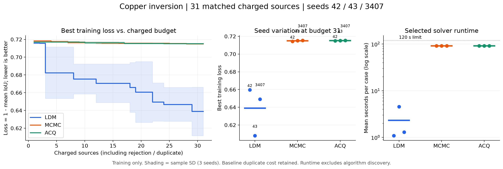
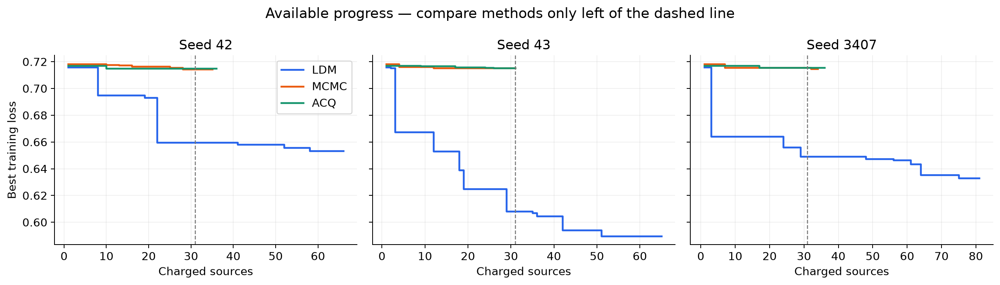

# 铜矿反演：阶段性结果可视化

2026-10-24，训练阶段快照。三种方法、发现种子42/43/3407，共同预算为31个计费源。曲线按预先选定候选顺序回顾绘制，不代表实时反馈可用时间。

| 方法 | 最佳训练损失均值 ± 样本标准差 | 平均IoU | 所选算法每case平均求解时间 |
|---|---:|---:|---:|
| LDM | 0.63894 ± 0.02732 | 0.36106 | 2.32秒 |
| MCMC | 0.71501 ± 0.00060 | 0.28499 | 91.31秒 |
| ACQ | 0.71524 ± 0.00020 | 0.28476 | 91.26秒 |

## 解读

1. **早期训练搜索更有效。** 在相同31个计费源下，LDM三个种子均领先，平均损失比两个基线低约0.076，即相对降低约10.6%–10.7%。对应IoU由约0.285提高到0.361，增加约7.6个百分点。不能将损失降幅当作识别准确率提升。
2. **算法执行快，完整发现成本尚不能这样比较。** 当前选中LDM算法每case平均2.32秒，基线约91秒，单次求解时间约相差39倍。此数不含API研究、接口验证、独立评分、队列或恢复成本，不能宣称端到端快39倍。单case上限对所有方法均120秒。
3. **LDM有更大的种子差异。** seed43明显更好，42较弱；LDM标准差约0.027，基线约0.0002–0.0006。三个种子都领先是积极信号，但不足以建立统计显著性或普遍稳定性。基线曲线较平只表明当前搜索几乎没有改善，不等同于高质量稳定。
4. **几何质量仍有明显提升空间。** 0.361是训练母体聚合IoU，不能据此认定已准确恢复矿体或具备真实矿区适用性。尚无独立验证、ID/OOD测试结果。当前数据是独立合成地质基准。

虚线表示31个共同计费源。右侧LDM继续改善，但那里方法进度不齐，不能作同预算胜负比较。当前LDM三个种子分别完成4/4/5轮，共65/65/81条已提交评分。

## 公平性与恢复记录

- 各完整候选使用相同48个训练case及每case120秒/2CPU/4GiB上限。
- LDM-42有1次研究阶段接口拒绝，在第2轮评分前计费；图中插入该槽位，不当作有效评分。
- 每组基线含1个历史重复源码版本，参数语义相同但序列化键顺序不同，已经同源恢复完成；该成本仍计入31源预算。因此基线取前30个参数条目加这个历史重复源，而不是前31参数条目。
- 这是保留故障成本的实际运行比较。重复源占用基线一次探索机会，故仍应披露其影响；不将本结果包装成无故障的算法能力基准。
- 均值阴影为三个种子的样本标准差，不是置信区间。拒绝槽位不改变当前best，乱序尚未补齐的前缀不加入图中。
- 总发现时间受到API等待、调度变更、重复/中断恢复影响，本图仅展示所选算法执行时间；旧的参数条目前缀耗时不冒充修正后的同预算耗时。

文件：`results.json` 为完整聚合曲线/快照，`matched-comparison.pdf` 可用于导出。图在远程用Matplotlib生成。
