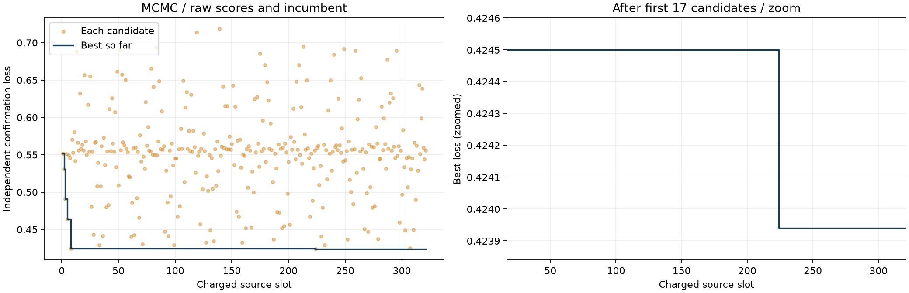
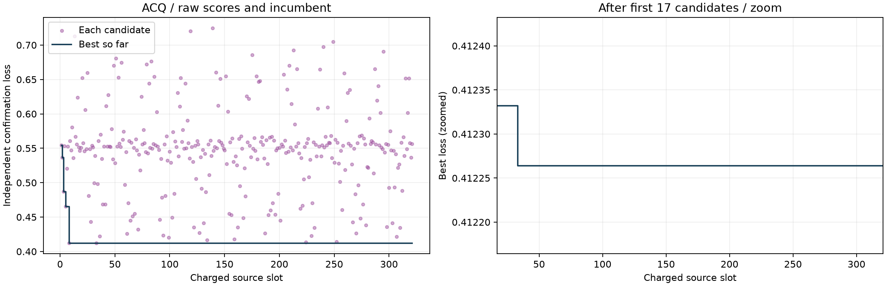
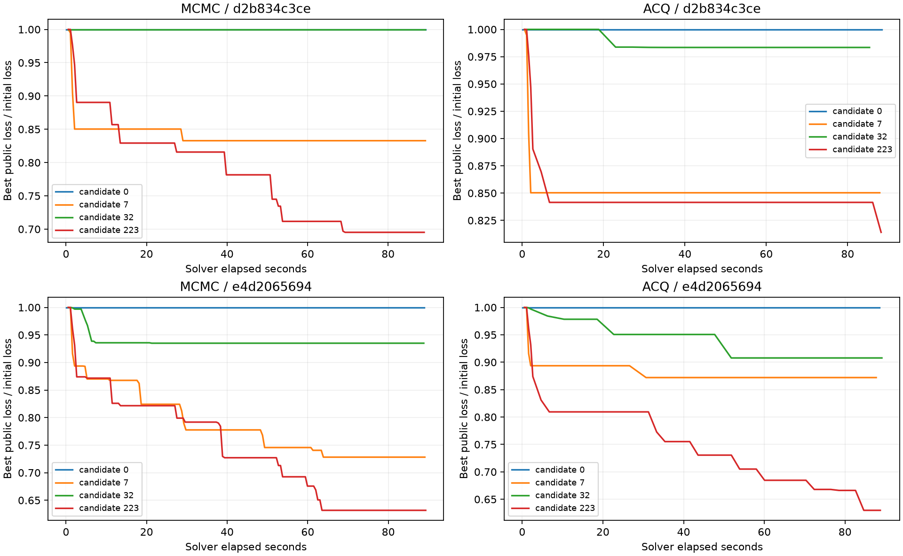

# 种子42基线曲线诊断

原图为外层参数搜索历史最佳，并非单次求解内层收敛曲线。两种基线采用冻结的Sobol超参序列，不依据批次分数更新后续参数。

|方法|前17候选最佳损失|最终最佳损失|后续相对降低|最后刷新候选序号（从1开始）|
|---|---:|---:|---:|---:|
|MCMC|0.424500598|0.423939946|0.1321%|224|
|ACQ|0.412332218|0.412264040|0.0165%|33|

每方法321个不同的训练分数。逐份重算聚合指标与原值一致；30,816条内层训练轨迹均可读取。MCMC/ACQ接受率约67.0%/72.9%，提议无效率均0%，所有ACQ轨迹都启用了采集。

[完整诊断页面](index.html) · [原始审计数据](audit.json)
