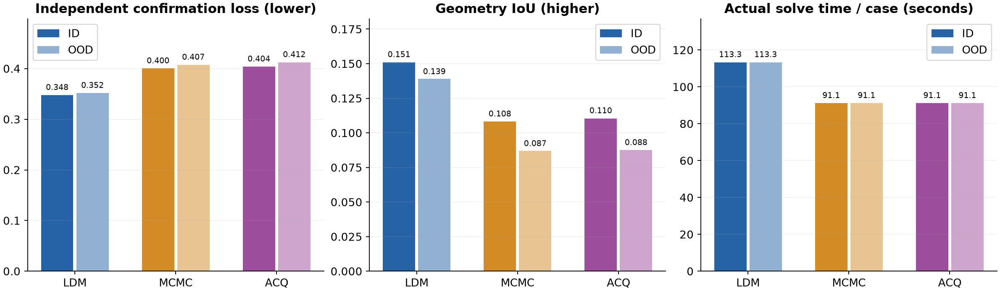
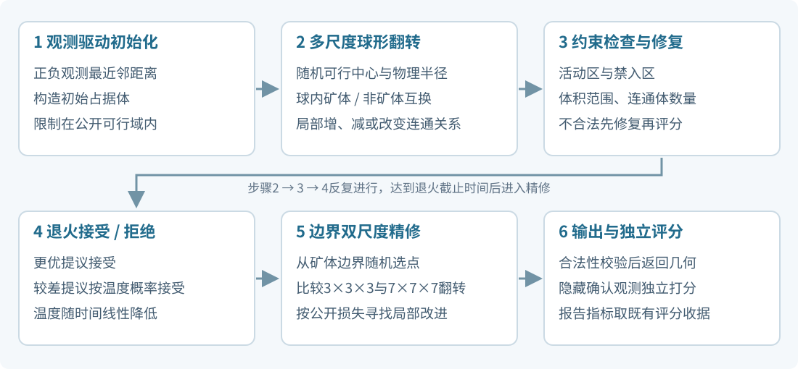
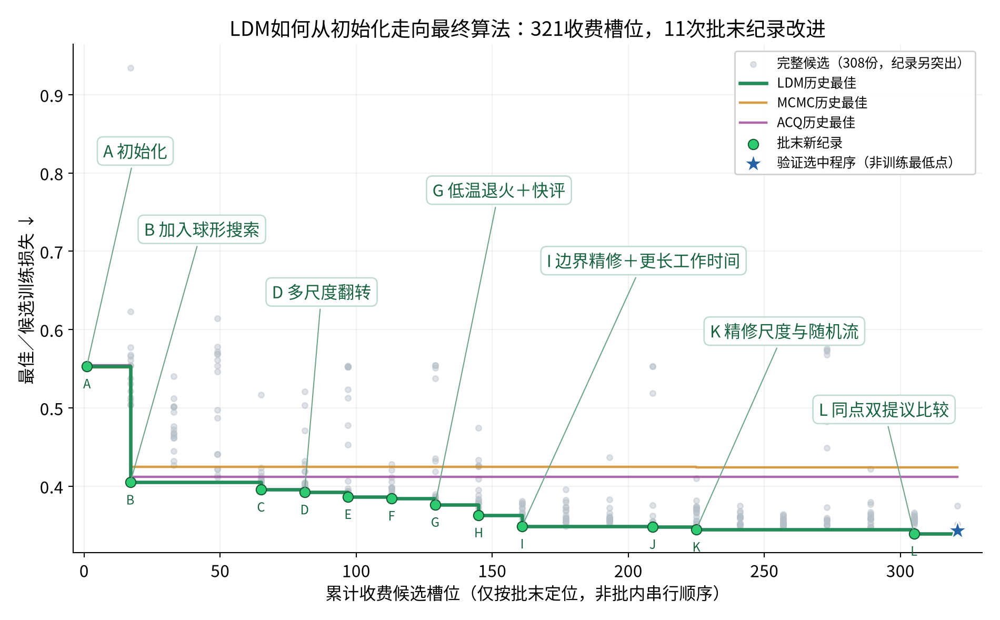
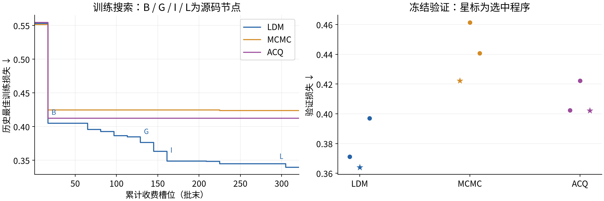
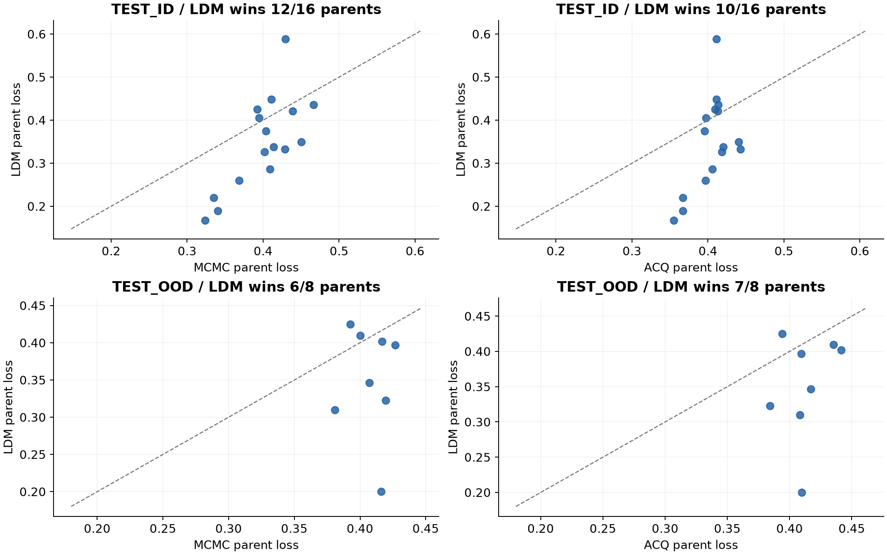
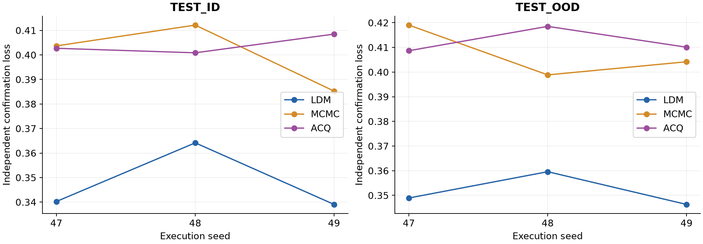

# 铜矿三维反演：发现种子42完整报告

## 1. 摘要与效果报告

LDM相对修复后的MCMC与ACQ，ID独立测量损失降低13.12% / 13.91%，OOD降低13.68% / 14.74%；单案例实际求解约113.3秒，对照约91.1秒。

## 2. 问题介绍

依据稀疏钻孔及露头观测，在公开地质约束内估计三维矿体。主指标按地质母体等权聚合独立确认观测效用，IoU衡量与真值矿体的体积重叠。

## 3. 方法介绍

最终选中算法可概括为“多尺度球形翻转退火＋边界局部精修”：公开观测最近邻初始化，物理尺度球内符号翻转，线性降温接受规则，约束修复，再做边界3³ / 7³邻域搜索。名义退火截止69.6秒，工作截止112.8秒，实际约113.3秒。

训练最佳为776ee0300e97…（训练损失0.339720，验证0.371223）；正式测试采用验证赢家2d2c33ed6a58…（训练0.343746，验证0.364064）。两者仅退火时间比例和随机偏移不同。

[算法详情与源码复核](algorithm-notes.html) · [原始赢家源码](source/ldm42-selected-solver.py) · [结构化审计](data/algorithm-audit.json)。复核发现精修best记录可能误存最后提议，已披露；不补评、不重选，结果取独立评分收据。

LDM进行多分支候选生成、融合选择与迭代研究；MCMC采用投影随机优化；ACQ增加在线代理模型和采集选择。训练321收费槽位，单案例120秒/2CPU/4GiB；验证3候选×16案例×执行47；测试ID32/OOD16×执行47/48/49。

### 三种算法比较与关键改进轨迹

LDM改写完整求解程序；MCMC在固定随机场优化器中调参；ACQ在相同优化器内增加在线贝叶斯岭回归与LCB提议筛选。三种方法的实际初始化、状态、提议、接受、约束与精修逐项对照见完整报告。

初始化加11次批末新纪录，共A–L十二个溯源节点；308份完整候选全部入图，13次收费接口拒绝不补分数。首批球形搜索、三尺度扩展、低温退火、边界精修及双提议比较均有源码与分数记录。

[交互轨迹与全部节点源码差异](trajectory.html) · [结构化轨迹](data/method-trajectory.json) · [画法参考：autoresearch](https://github.com/karpathy/autoresearch/blob/228791fb499afffb54b46200aca536f79142f117/analysis.ipynb)。

## 4. 实验结果与完整可视化

[完整排版报告](index.html) · [可打印PDF](copper-seed42-investor-report.pdf) · [全部144套案例及可旋转3D](browser.html) · [实验数据](data/report.json) · [来源摘要](data/provenance.json)

