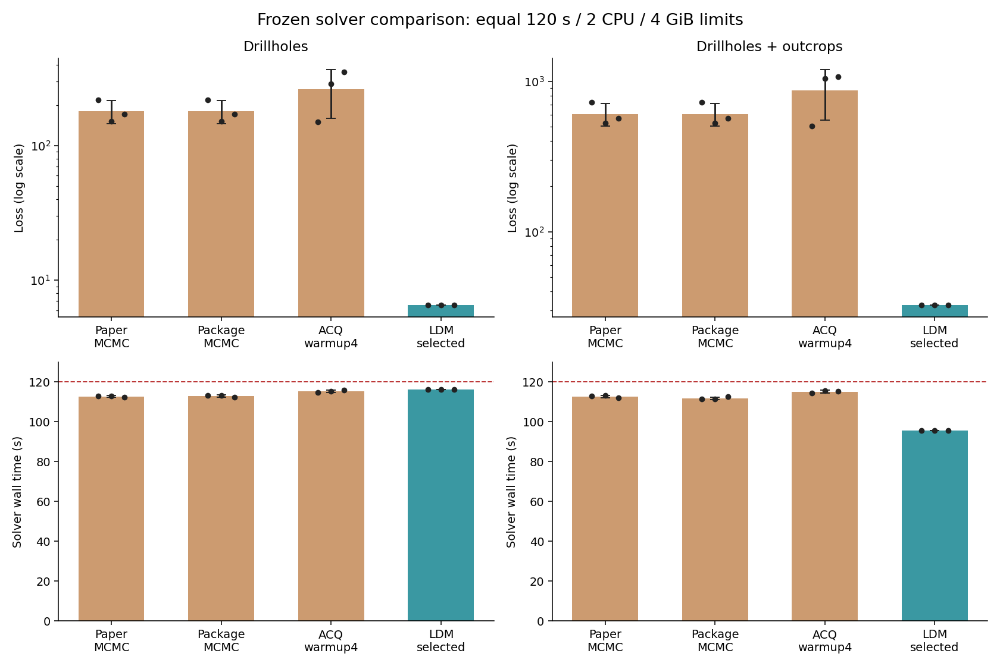
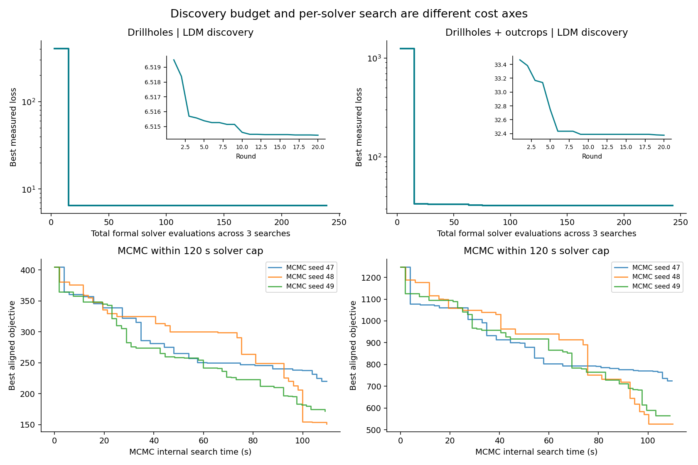
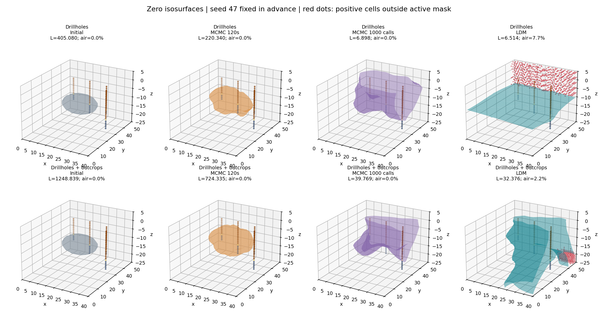
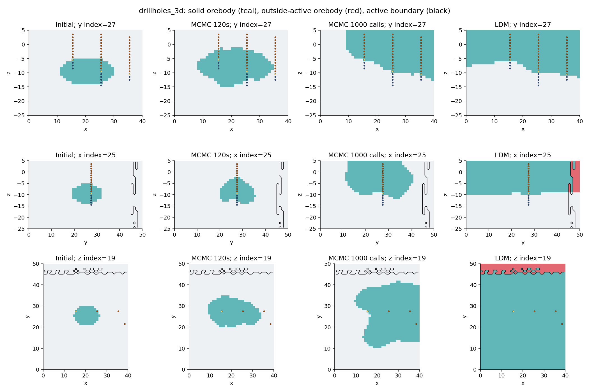
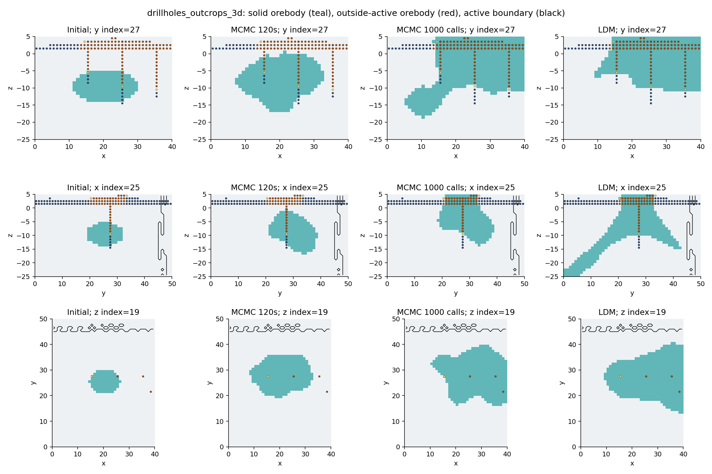
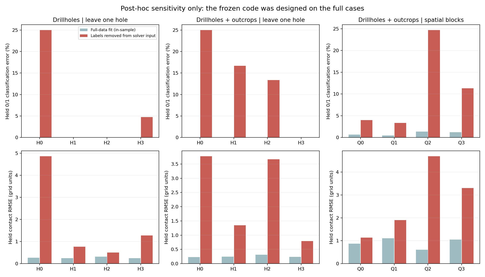

# LDM 在三维铜矿几何反演任务上的技术报告

**版本：2026-10-24｜最终冻结算法复验、源码审计与几何诊断**

## 摘要

LDM 在这两个已知案例上，生成了比当前蒙特卡洛基线更有效的**测量拟合算法**。在每次 120 秒、2 CPU、4 GiB 的相同求解资源上限下，钻孔案例损失为 **6.514470 ± 0.000057**，钻孔加露头为 **32.376328 ± 0.000245**；相对同预算论文 MCMC 的平均损失，分别降低约 **96.4% 和 94.7%**。

源码和几何检查同时说明：这还不是“恢复真实矿体”的证据。钻孔算法带有恰好四个接触点的专用分支与固定参数；低损失解延展到五个模型边界面，约 **7.73%** 的正值体积位于非活动区。露头算法更通用，但同样存在边界截断和约 **2.23%** 的非活动区正值体积。冻结算法的留整孔诊断也出现明显误差。

**应采用的结论：LDM 成功自动设计了高效的已知数据拟合程序；独立泛化能力、矿体真实性及不确定性质量尚未建立。**

### 阅读入口

- [交互式三维矿体：可旋转、缩放](orebodies-interactive.html)
- 本报告包含性能、搜索过程、3D 表面、正交剖面和缺测诊断图。
- 机器证据：本目录的 `geometry.json`、`search-curves.json`，及任务 evidence 下的 `final-solvers/`。

## 1. 问题到底是什么

当前任务是在 **40 × 50 × 30 = 60,000** 个网格上恢复一个隐式场 `f(x,y,z)`，以 `f>0` 表示目标地质单元，`f=0` 表示接触面。网格原点为 `(0,0,-25)`，间距均为 1；本文使用“网格单位”，不擅自解释为米。

| 数据 | 钻孔案例 | 钻孔＋露头案例 |
|---|---:|---:|
| 钻孔条目 | 70：15负类、4接触、51正类 | 相同70条 |
| 钻孔横向位置 | 4个 | 相同4个 |
| 露头条目 | 无 | 3,530：2,674负类、26接触、830正类 |
| 初始模型、网格和活动掩码 | 给定 | 给定 |

两例共享同一网格和钻孔数据，第二例增加露头约束；它们不是两个独立矿区。当前包未提供可作为独立评价目标的完整真实矿体；初始模型是起点，不能当成 ground truth。测量在这里是**地质类别与接触点**，不是重力、电磁或其他地球物理观测。当前实现没有“物性模型→物理场观测”的前向算子，也没有反演铜品位。

### 1.1 评分目标

独立评分器先用 fast marching 将输出转换为带符号距离 `φ = SDF(f)`，再对每类观测求和：

\[
L_o=w_o\left[\sum_{y=0}\operatorname{softplus}(\phi)+\sum_{y>0}\operatorname{softplus}(-\phi)+\bar\phi_C^2+\frac{1}{|C|}\sum_{i\in C}\phi_i^2\right].
\]

`C` 是标签为 0.5 的接触点；无接触点时后两项为零。总损失为钻孔项加露头项，权重分别为 **1 和 0.1**。

关键性质：

1. 接触点同时进入正类 logistic 项和接触距离项。这使“接触距离严格为零”不一定是总目标最优；略偏正侧可能更有利。
2. 损失没有按观测数归一化；露头数据量大，尽管权重为0.1，仍有较大影响。不同留出集合的原始损失不能直接互比。
3. 当前目标**没有**非活动区惩罚、矿体体积先验、连通性约束、边界闭合条件或独立粗糙度惩罚。
4. 评分器重建距离场能防止简单缩放场值来作弊，但不能排除对测点拟合很好、未观测区域形态不合理的解。

## 2. 将三种表征统一作为 LDM

AST、Qwen embedding 和二者融合，都是 LDM 搜索中的代码表征配置。本报告主图统一标为 **LDM**，具体采用以下规则：

> 对每个 case，依据原搜索阶段的独立测量损失，在三条搜索轨迹的所有成功候选中选一个最佳程序；随后冻结源码，用 seeds 47/48/49 复验。没有按复验种子分别挑程序，也没有拼接多个输出矿体。

因此选中的是钻孔 AST 路径的程序、露头 Qwen 路径的程序。三种表征的来源仍保留在审计记录中；“合并为 LDM”是方法归类与程序择优，不是已有一个经过验证、能自动适配未知矿区的统一求解器。

| 项目 | 钻孔 | 钻孔＋露头 |
|---|---|---|
| 最终选择来源 | AST搜索，20轮 | Qwen搜索，20轮 |
| 三条轨迹实际轮数 | 20 / 20 / 19 | 20 / 20 / 20 |
| 合计正式评分尝试，含各自初始模型 | **239** | **243** |

两case合计 **482次正式评分尝试**。

钻孔融合因 Harness 计数达到上限停在19轮，未增加预算补齐。LDM 的整套发现成本必须计入三条搜索，不能把择优后的成绩归到单条81次预算。六条搜索还发生了模型请求、接口检查、编码与GP选择等费用；同资源求解比较不包含这些发现成本。

运行使用 DeepSeek 官方 Flash / low、每轮16个候选、4个正式评分。当前研究树包含 main research 和4个 researcher profile，不能描述成每轮只调用一次模型。编码影响候选选择；最终求解器运行时不再调用 LLM 或 embedding。

### 2.1 LDM如何搜索算法

闭环是：历史测量与代码反馈 → agent提出完整 `solve(problem,budget,seed)` 程序 → 固定只读接口检查 → 代码表征与GP代理选择 → 受限容器执行 → 独立评分 → 把真实反馈交回下一轮。

代码先经过 `ast.parse` / `ast.unparse` 规范化。结构特征为256维，Qwen3-Embedding-0.6B表征为1024维；融合配置对两个L2归一化向量分别乘以 `1/√2` 后拼接为1280维。GP根据历史程序表征与测量效用指导选点，研究树负责保留和分配探索分支。这里的BO搜索对象是**程序**，程序运行后才得到矿体；不把某份矿体体素直接作为BO编码。

接口合法性检查保证输入不可写、返回形状和数值合法等执行契约；它不自动保证地质合理或泛化。评分进程不挂载候选源码，只接收冻结模型与数据，因此候选自报的loss不会直接成为正式成绩。

## 3. 最佳程序实际采用的方法

### 3.1 钻孔：接触面插值＋局部校正＋坐标下降

选中源码：`8edb42991a675a0e21d93c0d26a57a39bbae79d2c7c9347731ebc01b11630421`。

主分支要求 **3D、z为竖向、恰好4个接触点，且存在正负类**。算法把目标化为单值高度面 `z=B(x,y)`，构造 `f=z−B(x,y)`：

1. 根据接触点坐标做各向异性加权反距离插值；不同孔使用不同横向尺度和竖向偏移。
2. 加入低阶至四阶多项式项，以及围绕接触点的两尺度 Gaussian 修正。
3. 在接触点附近构造非均匀双线性控制网格，进一步调整接触面。
4. 用随机次序坐标下降、小步长自适应细化，在时间上限内直接降低与评分器一致的完整距离场损失。

这把一般3D场搜索压缩成一个受四个接触点支配的高度面问题，很快就能得到几乎无钻孔分类错误的解。它的代价是很强的形状假设：不能自然表达多层反复穿越、复杂封闭透镜体或某些分叉结构。

源码顶部包含 `_D`、`_SX`、`_SY`、`_CT` 等固定数组和标量；它们按四个接触点的枚举次序使用。没有发现直接粘贴完整60,000体素答案的数组，但这些常数与专用分支已经构成明显的案例适配。若接触点数不是4，主流程不执行，而改用平面或球面回退。

### 3.2 钻孔＋露头：距离变换初始化＋水平集优化＋局部凸起搜索

选中源码：`c004c9198f9fd9aa339530930b6afe5726637bcb56a1c227ea047ff44cd29f7f`。

1. 根据正负标签构造最近距离 `d_pos` 和 `d_neg`。
2. 从若干 `GaussianFilter(d_neg−k·d_pos)` 初始场中，按完整目标选优。
3. 对数据拟合代理梯度做水平集更新，加局部平滑，每5步重建距离场。
4. 在高残差或接触位置进行多尺度 Gaussian bump 坐标搜索，包含各向异性核和小幅细化。
5. 后段以窄带距离场筛选候选，对接受的变更再用完整目标核验，并保留历史最优场。

这是一套测量驱动的确定性局部优化器。需要注意，代码中的“梯度”是启发式更新：接触点已进入正类梯度，接触分支又加入一项相同方向的 logistic 梯度，因此不应称为严格的完整目标梯度下降；最终好坏仍由完整距离场目标核验。

该算法没有钻孔算法那样的“四接触点开关”，但 seed组合、时间分配、核尺度和迭代设置均经过当前case反复反馈调优。代码注释直接记录了当前测量上的历史分数，说明它也不是未经调参的通用方法。距离变换初始化未显式传入物理 spacing；当前单位网格可用，非单位网格的泛化未被验证。

### 3.3 其他路径的最佳程序

| 来源 | 核心方法 | 本报告角色 |
|---|---|---|
| 钻孔 Qwen | 每孔旋转各向异性指数混合、flat-top核、参数优化 | LDM候选来源，未选为最终程序 |
| 钻孔融合，19轮 | 紧支撑平台面、多尺度Gaussian修正、分阶段控制网格优化 | LDM候选来源，预算停止记录保留 |
| 露头 AST | 标签密度平滑、残差boosting、逐体素/邻域翻转、接触位置修正 | LDM候选来源 |
| 露头融合 | 距离变换/KDE初始场、平滑梯度细化、全局基函数和控制网格校正 | LDM候选来源 |

这里“融合”指代码编码融合，不是把多个矿体作几何融合。

## 4. 为什么比蒙特卡洛低这么多

### 4.1 目标导向与搜索空间不同

原 sampler 从给定初始体出发，用随机 Gaussian 速度场扰动水平集，按温度控制的接受规则推进。其实现使用 `(L_current²−L_candidate²)/T` 决定接受概率。它同时承担随机几何建模和不确定性探索职责；LDM程序则专门追求当前数据的单个最小损失。

LDM直接读标签、接触点和目标函数结构，先构造贴近观测的场，再做局部校正。MCMC 在120秒内仍需要从较差的初始体逐步长到观测所在位置；LDM则用插值或距离变换跳过了这个阶段。

### 4.2 相同秒数不等于相同内部工作量

同预算 MCMC 每次大约完成58～59次完整目标调用；ACQ约16次，原预热30次甚至没结束。最终 LDM 的局部参数化、缓存基函数和窄带计算可以安排不同数量、不同成本的内部计算。其优势包含算法实现和初始化效率，不是“外层81次评分就等价于81个MCMC提案”。

为核实机制，额外在隔离容器中运行了两份**插桩副本**，计数 `skfmm.distance` 调用。它们有独立源码身份，仅用于分析，没有覆盖18次正式复验：

| 插桩诊断，seed47 | 完整距离重建 | 窄带距离重建 | 首个初值损失 | 插桩输出独立损失 |
|---|---:|---:|---:|---:|
| 钻孔 LDM | 3,935 | 0 | 6.515520 | 6.514417 |
| 露头 LDM | 1,052 | 6,912 | 33.148449 | 32.376045 |

这些计数是距离重建次数，不能与MCMC的目标调用直接等同。插桩也会轻微影响时间截止。尽管如此，强初值已经十分明确：相对原初始场损失405.08 / 1248.84，LDM第一次评价就达到6.5155 / 33.148，后续才做细化。钻孔初值还包含此前搜索得到的固定参数，其发现成本不能视为免费。露头窄带筛选把大量局部尝试做得更便宜，并以完整目标保留较优场。

### 4.3 还利用了当前目标的自由度

只要有利于测点距离与分类，程序可以把矿体扩展到未观测区域、模型边界甚至非活动区，而不受目标处罚。钻孔case的低损失部分来自这个欠约束性。低损失是真实独立评分结果，但“评分正确”与“地质目标完备”是两件不同的事。

### 4.4 更多MCMC预算会显著缩小差距

原配置1000次调用的三种子损失为钻孔 **6.940534 ± 0.061205**、露头 **37.720632 ± 1.898491**，各约31.5分钟。相较同预算表中的巨大差距，这时差距小得多。该轨道的接受目标保留作者原实现，最终另做统一独立评分，不能与120秒轨道混成一条公平曲线。

## 5. 同资源性能与稳定性

所有数字为三个种子；损失为均值 ± 样本标准差。传统基线复用已完成的同镜像、同资源结果。LDM取每case固定的最终程序，没有挑最好seed。

| 方法 | 钻孔损失 | 求解秒 | 钻孔＋露头损失 | 求解秒 |
|---|---:|---:|---:|---:|
| 论文 MCMC，目标对齐 | 181.404270 ± 35.289956 | 112.68 | 605.561971 ± 104.570798 | 112.71 |
| Package MCMC | 181.404270 ± 35.289956 | 112.89 | 605.561971 ± 104.570798 | 111.75 |
| ACQ，预热4适配 | 263.485915 ± 103.353109 | 115.28 | 870.861317 ± 318.607267 | 115.15 |
| **LDM，冻结最佳程序** | **6.514470 ± 0.000057** | **116.35** | **32.376328 ± 0.000245** | **95.53** |

三种子稳定说明这些冻结程序在当前输入上的执行结果可复现，不说明算法发现稳定或跨矿区泛化。钻孔三次二值矿体的两两IoU约 **0.9957～0.9980**，145个体素在三次中发生过分类变化；露头三次二值矿体完全相同，但连续距离和损失有轻微差异。运行种子不是后验矿体样本，不能拿它们估计地质不确定性。

## 6. 搜索曲线与收益

上排为三条LDM搜索按轮次合并的历史最优包络，横轴计入三条轨迹累计正式评分。第一轮就获得大部分损失下降，后续主要做很小的细化。它是事后组合搜索结果的曲线，不是一个已验证的在线多配置调度器。

下排为MCMC三个种子在120秒内的内部搜索曲线。上下排横轴含义不同，刻意分开：不能把LDM的一次整段算法评估与MCMC的一次矿体目标调用当成同一单位。

## 7. 3D矿体是否合理

所有图预先固定 **seed47**，不是按视觉效果或损失选seed。四列分别为初始、120秒MCMC、1000调用MCMC与LDM；使用相同物理坐标、相同视角，不对非活动区做裁剪。红点/红块为正值场落在非活动区的部分。

钻孔观测点：深蓝为负类，金色为接触点，棕色为正类。初始模型仅作起点参照，不是地质真值。

> 3D图显示零等值面，不包含模型盒子人为封口面；边界截断的矿体不能仅凭开放表面的样子判断闭合性。剖面图用实体占据显示正值区域。

| Case / 方法，seed47 | 正值体素 | 非活动区正值体素 | 分类错点 | 接触RMSE | 触及模型边界面数 |
|---|---:|---:|---:|---:|---:|
| 钻孔 MCMC 120秒 | 3,038 | 0 | 47 | 3.6950 | 0 |
| 钻孔 MCMC 1000调用 | 11,173 | 0 | 0 | 0.1507 | 2 |
| 钻孔 LDM | **28,317** | **2,188** | **0** | 0.2703 | **5** |
| 露头 MCMC 120秒 | 3,999 | 0 | 874 | 6.6776 | 0 |
| 露头 MCMC 1000调用 | 7,668 | 0 | 79 | 1.1317 | 2 |
| 露头 LDM | **10,651** | **238** | **34** | 0.9121 | **5** |

以上展示对象均只有一个6邻接连通分量，因此问题不是大量碎片，而是**范围与形态欠约束**。触边本身不必然错误，地质体可以延伸出测区；但缺少边界外证据时，不能确认其延展合理。非活动区语义沿用当前任务掩码，不把每个非活动格未经核实地解释成真实空气。

### 7.1 钻孔case：接触面拟合好，三维范围缺乏约束

LDM把界面上方的大面积区域都判成正类，正值体积约为1000调用MCMC的 **2.53倍**。它穿过四个孔的类别转换位置，分类错误为零，但横向未观测区域被大范围外推，触及x两侧、y两侧及z上边界。其接触RMSE还略高于1000调用MCMC，说明更低总损失不意味着每一项地质指标都更好。

这可被解释为一个“接触面以上为目标单元”的地层模型；若问题要求有限、闭合的矿体，它就不充分。没有真实体或外部地质先验，不能判定哪一个体积是真实答案。

### 7.2 露头case：空间限制更强，但仍非唯一合理矿体

露头约束显著缩小了LDM正值体积，但存在一片向深部/域边界延伸的结构，且有238个非活动区正值格。34个分类不匹配没有被隐藏；总损失由钻孔约7.5034和加权露头约24.8727组成。模型更符合当前测量，不代表已得到铜矿资源量或可靠的深部矿体边界。

## 8. 过拟合与缺测诊断

### 8.1 已有明确风险证据

- **架构特化：**钻孔算法要求恰好4个接触点，移除一孔即切换成不同的回退算法。
- **参数适配：**固定接触点数组、时间切分、核尺度等经同一case反馈优化，程序注释也含历史分数。
- **数据复用：**全部发现过程都使用这两个已知case，没有独立验证集；两case还共享钻孔与网格。
- **目标缺口：**不约束体积、非活动区或闭合性，允许优化器取得拟合分数但产生缺乏地质支持的外推。

这些证据足以否定“已经证明通用反演能力”的说法，但不能单凭硬编码常数断言全部改善都是过拟合；数据驱动初始化、局部参数化和窄带筛选确实是有效算法设计。

### 8.2 诊断设计与边界

新增12次冻结代码诊断：两个case各留一整孔，共8折；露头case再按x/y中点分四个空间象限，各留出该区内全部测量，共4折。训练输入中留出观测被设为NaN，输出仍由隔离评分器评估训练/留出/完整观测。每次仍为120秒、2CPU、4GiB，seed47。

**这些是事后敏感性检查，不是无偏验证。**程序此前已通过完整数据被设计和选择，固定常数与给定初始模型仍可能携带信息；没有重新从训练折进行LDM搜索。诊断出现明显退化能揭示脆弱性，诊断表现好也不能证明独立泛化。分类错误率只对0/1标签计算，接触点单独报告RMSE。

### 8.3 留整孔：12次诊断中的前8折

四口孔按横向索引 `(15,27)、(25,27)、(35,27)、(38,21)` 排序，分别为H0～H3。

| 冻结程序 | 留出孔 | 留出0/1错点 / 数量 | 错误率 | 留出接触RMSE |
|---|---|---:|---:|---:|
| 钻孔LDM | H0 | 3 / 12 | 25.00% | 4.8642 |
| 钻孔LDM | H1 | 0 / 18 | 0% | 0.7639 |
| 钻孔LDM | H2 | 0 / 15 | 0% | 0.4985 |
| 钻孔LDM | H3 | 1 / 21 | 4.76% | 1.2722 |
| 露头LDM | H0 | 3 / 12 | 25.00% | 3.7740 |
| 露头LDM | H1 | 3 / 18 | 16.67% | 1.3455 |
| 露头LDM | H2 | 2 / 15 | 13.33% | 3.6634 |
| 露头LDM | H3 | 0 / 21 | 0% | 0.7918 |

钻孔算法留一孔即剩3接触点，按源码确定进入平面回退。其四折留出二值错点合计 **4/66 = 6.06%**，H0接触偏离4.86个网格单位；原完整数据上钻孔分类错误为零。露头算法保留全部露头、仅移除一口钻孔时，四折合计 **8/66 = 12.12%**。不能把两个百分比作为通用算法排名：程序和训练约束不同，而且都是事后诊断。

### 8.4 空间分块：露头case再做4折

Q0=`x<20,y<25`，Q1=`x<20,y≥25`，Q2=`x≥20,y<25`，Q3=`x≥20,y≥25`，此处x/y为网格索引。每次移除该象限内所有钻孔和露头标签，保留给定初始模型。

| 留出块 | 0/1错点 / 数量 | 错误率 | 留出接触RMSE |
|---|---:|---:|---:|
| Q0 | 25 / 624 | 4.01% | 1.1404 |
| Q1 | 30 / 895 | 3.35% | 1.9062 |
| Q2 | **240 / 972** | **24.69%** | **4.6942** |
| Q3 | 122 / 1,079 | 11.31% | 3.3020 |

四块合计 **417/3,570 = 11.68%**；完整数据拟合的原输出在相同全部二值标签上为 **34/3,570 = 0.95%**。后者是in-sample参照，不是公平的另一种泛化方法。空间留出后Q2/Q3明显退化，说明依靠稀疏标签外推深部/横向结构仍不可靠。

12次solver及隔离评分均成功，没有重新设计或调参。技术上“合法且能运行”与统计上“能泛化”必须分开。当前最准确的表述是：**存在强案例适配和缺测脆弱性证据；需要真正隔离的任务分布才能量化过拟合程度。**

## 9. 下一阶段应如何改造任务

1. **先明确地质假设。**若目标单元不允许出现在非活动区，应通过输出可行域或独立评分硬约束实现；若掩码不是空气，应先核实其语义。
2. **建立开发/验证/测试三级case。**按独立矿体、钻孔布局、缺测模式、网格spacing划分；只在开发集做RSI，验证集选算法，封存测试集一次汇报。当前两个共享数据的case不能承担这三个角色。
3. **增加合理性指标。**同时报告非活动区占比、体积、表面积、连通分量、触边、接触误差、标签误差；有真实模型时报告IoU及表面距离。不要只保留总损失。
4. **将正则与任务先验显式化。**根据地质问题加入范围、光滑性、结构/拓扑或边界约束，明确权重与单位；不要因为图像“不好看”而事后偷偷修改评分。
5. **分开优化与不确定性任务。**最佳拟合程序与后验采样器应在不同指标上比较。若目标是概率建模，要比较校准、覆盖率和多模态探索，不能用三个执行seed充当后验。
6. **保留完整成本口径。**单独报告算法发现成本、冻结算法每次求解成本和目标调用/距离重建次数；多表征择优应计入全部轨迹。
7. **补齐确定性基线。**增加未经LDM调参的距离变换初值、接触面RBF/IDW插值、标准局部优化器。当前结果证明优于这组MCMC实现，不足以证明优于成熟的手工确定性反演算法，也无法完全拆分“LLM发现能力”与“采用强初值/局部优化”的贡献。

## 10. 可复现性与来源

- 运行位置：H20 `/Aidata/shared/ldm/`；分析目录 `copper-technical-report-20261024/`。
- 最终复验目录：`copper-baselines-20261024/matched-120s-final-search/`；18/18成功。
- 同资源基线：`matched-120s-v2/` 与 `matched-120s-acq-warmup4/`；原配置复现：`paper-1000-v2/`。
- 独立评分器固定镜像 `sha256:9c0c855e43120f0000e3e5dcf79002763c65e55839e4908306cac29d1ff71062`，共同求解镜像 `sha256:f6856385a0da9444b1e5edb5048b2f6081593fe568c3473c2fda524d0c4489f5`。
- 本次静态图与HTML使用单独绘图环境，未改动原实验环境；可视化未修改输出矿体或原评分。
- 六份冻结算法源码保存在本目录 `sources/`，其中主结果对应 [钻孔算法](sources/drillholes_3d_ast.py) 与 [露头算法](sources/drillholes_outcrops_3d_qwen.py)。诊断结果为 `holdout-summary.json` / `holdout-metrics.json`；插桩证据为 `profile-summary.json`。
- 原论文：Wei et al., *Knowledge-driven stochastic modeling of geological geometry features conditioned on drillholes and outcrop contacts*, Computers & Geosciences, 2024, 105779。[论文 DOI](https://doi.org/10.1016/j.cageo.2024.105779)。
- [作者仓库](https://github.com/xiaolongw1223/Knowledge-driven-stochastic-modeling)明确包括3D水平集Monte Carlo和不确定性量化；本实验基线源码固定在历史归档提交 `94b8615bb2a9ca135583852a23ba114964a4b5af`。

### 结论

LDM 在本任务上最有价值的成果，是自动发现了“从观测构造强初值，再在合适的参数化空间进行局部优化”的求解策略。现有结果支持显著的拟合效率改善，同时也暴露了任务目标与地质真实性之间的缺口。下一步应优先完善评价环境和独立case，而不是继续把现有两个case的小数位压低。
