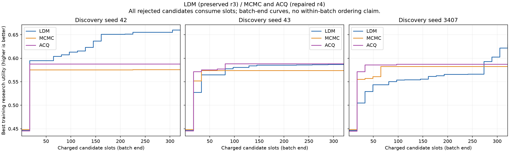

# 铜矿 v2 正式合成基准：20×16、三个发现种子

## 种子42展示报告：算法对照与源码改进轨迹（2026-11-02）

按用户当前展示范围，仅使用发现种子42。[18页完整报告](copper-seed42-final-20261031/index.html)及[PDF](copper-seed42-final-20261031/copper-seed42-investor-report.pdf)包含LDM六步流程图、有效参数与伪代码、训练最佳／验证赢家对照，以及修复后MCMC和ACQ的提议、接受、约束与实际参数比较。[完整案例浏览器](copper-seed42-final-20261031/browser.html)保留全部48案例×执行47/48/49的144套同坐标比较。

[带源码溯源的交互改进轨迹](copper-seed42-final-20261031/trajectory.html)参考autoresearch的淡色候选点、突出纪录点、历史最佳阶梯和改动标注，保留本实验批末预算语义。308份完整候选全部入图；13次收费接口拒绝不虚构分数。A–L对应初始化及11次批末纪录改进，每个节点附源码、相邻纪录差异、训练损失与实际秒。关键演进包括球形贪心搜索、多尺度翻转、低温退火、快速评分、边界精修与双提议比较；相邻纪录不冒充直接父子关系，分数差不解释为单组件消融效应。第10轮工作截止比例0.68→0.94，实际平均秒约83→114，已与代码改动一同披露。训练最佳点与第20轮验证赢家用不同标记区分。

最终算法可概括为“多尺度球形翻转退火＋边界局部精修”：共享公开观测初始化、多尺度球内符号翻转、线性降温接受、约束修复、边界双尺度立方翻转。正式测试赢家源码为 `2d2c33ed6a588d9e444a104d135c8d358ca715e6cf061130a92bf5fd0d1c9d0b`；训练最佳为 `776ee0300e9757563c2d5e1b087c3499f111b2bfd9b7dfa979c35f3c8cc979fd`。两者函数体相同，仅退火截止比例0.56→0.58及随机偏移31→41不同。最终赢家训练／验证损失0.343746／0.364064；训练最佳0.339720／0.371223，未将训练最佳替代正式测试赢家。

本次源码复核发现：冻结赢家的 `best_pair` 第321行可能将最后提议的模型与选中提议的内部最佳分数错配。隔离单元探针已复现；该探针不测量正式案例影响。报告已披露，既有源码、赢家、科学评估与测试几何保持原样，未补评或重选。报告指标取外部评分器对实际返回模型的既有收据，不取内部 `best_l`。[源码说明与复核证据](copper-seed42-final-20261031/algorithm-notes.html)。

## 修复后 r4：最终报告交付（明确披露验证偏差）（2026-10-31）

新 MCMC/ACQ 六组训练全部完成，每组321个收费候选、15408个训练案例，共92448个案例；预算对账通过并统一封存。固定赢家 ID32/OOD16、执行种子47/48/49的864份测试案例收据全部成功，六个赢家在测试期间未改变，完成重放未改动收据。LDM继续复用原r3冻结结果，未重跑或重选。

**已接受并保留披露的协议偏差：** r4冻结验证清单实际仅含执行种子47，各组用3候选×16案例选型；未执行本轮要求的验证种子48/49。测试已完成，不能根据测试反馈补做选型或更换赢家。用户于2026-10-31明确接受保留当前赢家并披露该偏差，不再补评或重选。本交付不声称完成原要求的三执行种子验证。

证据：[验证种子偏差](copper-baseline-rerun-20261027/validation-seed-discrepancy-20261031-0519.json)、[测试完成核验](copper-baseline-rerun-20261027/test-stage-20261031-0549.json)、[六组报告数据草稿及文件摘要](copper-baseline-rerun-20261027/report-data-draft-20261031.json)。432套全案例图已生成并同步，图像摘要全部核验通过；训练、验证、测试、种子稳定性、资源成本与全案例浏览器报告已整理；按用户已接受的偏差口径完成最终交付。

本轮属于同一基准修复后的复评，并非首次盲测；相同硬上限不等于相同实际耗时；投影随机优化适配器不主张严格后验MCMC。

## 最终报告与案例浏览

- [全部48案例、432套发现/执行种子切换](copper-baseline-rerun-20261027/all-case-visual-draft-20261031/index.html)：每套真值/LDM/MCMC/ACQ同坐标3D、三正交切片、观测、非活动区、IoU和实际秒。全部1296份模型及收据摘要已核对；已完成静态抽检；远程Chromium已遍历全部432种组合，图像解码和原图链接全部通过，无页面JavaScript异常。隔离安装中文字体后完成页面截图复查，中文、选择器和图像显示正常。
- [ID/OOD与发现种子汇总](copper-baseline-rerun-20261027/test-summary-draft-20261031.html)。
- [训练曲线原始数据](copper-baseline-rerun-20261027/training-curves-source-draft-20261031.json)与[成本统计](copper-baseline-rerun-20261027/training-cost-draft-20261031.json)。求解器墙钟秒之和不等于实验经过时间、CPU时间或货币成本。

训练图仅含原LDM及新MCMC/ACQ。横轴为批末累计收费槽位，每组321；LDM42/43分别有13/2个收费接口拒绝，因此实际得到308/319份完整评估，LDM3407及新六组均321份。拒绝不补评；批末阶梯图不推断批内完成顺序。

[旧r3及更早报告归档](copper-v2-formal-study-r3-archive-20261031.md)。旧基线曲线与数值未混入本页的新比较。

## 验证选型与实际训练资源

下表验证指标仅来自执行种子47，保留原固定赢家；不得解读为三执行种子验证完成。CPU小时取私有账本 `through_reap`，求解墙钟小时为各任务累加，包含并发，不能当作实验经过时间。接口和评分器单独计入，未并入求解时间。

|方法|发现种子|选中验证损失|验证IoU|训练求解墙钟小时|训练求解CPU小时|接口CPU小时|评分CPU小时|
|---|---:|---:|---:|---:|---:|---:|---:|
|LDM|42|0.364064|0.127397|371.73|368.35|0.72|1.91|
|LDM|43|0.453302|0.179790|380.52|377.16|1.84|1.90|
|LDM|3407|0.378937|0.145144|250.51|246.76|0.87|2.06|
|MCMC|42|0.422347|0.098147|390.12|388.29|2.23|1.36|
|MCMC|43|0.438401|0.098450|390.13|388.29|2.23|1.36|
|MCMC|3407|0.415476|0.118910|390.11|388.28|2.23|1.36|
|ACQ|42|0.402101|0.105984|390.09|388.31|2.23|1.36|
|ACQ|43|0.395350|0.108231|390.13|388.29|2.23|1.37|
|ACQ|3407|0.408533|0.112761|390.16|388.30|2.23|1.36|

[九组验证与资源账本摘要](copper-baseline-rerun-20261027/validation-resource-audit-draft-20261031.json)。本次再次核对r3的29份保护文件，摘要全部不变。上述资源计数不包含所有开发验收、故障恢复与API开销，不能作为完整货币成本；缺失项不记零。

## 固定赢家 ID/OOD 与种子稳定性

均值±样本标准差跨三个发现种子；每个发现种子的测试均含执行种子47/48/49。损失越低越好，IoU为辅助几何指标。所有1296次测试求解成功，合法率100%。

|方法|分布|损失|IoU|每案例实际求解秒|
|---|---|---:|---:|---:|
|LDM|test_id|0.361726 ± 0.032651|0.185662 ± 0.040726|112.563046 ± 1.227320|
|LDM|test_ood|0.395486 ± 0.083478|0.197732 ± 0.072492|112.552833 ± 1.229376|
|MCMC|test_id|0.414869 ± 0.013482|0.108295 ± 0.000224|91.106273 ± 0.032366|
|MCMC|test_ood|0.420851 ± 0.011684|0.088262 ± 0.001101|91.123354 ± 0.006125|
|ACQ|test_id|0.406996 ± 0.003054|0.109087 ± 0.001309|91.100118 ± 0.016975|
|ACQ|test_ood|0.411463 ± 0.001022|0.088547 ± 0.001069|91.105967 ± 0.044828|

LDM的平均ID/OOD损失低于修复后的两种基线，但OOD跨发现种子的波动更大，不能据此声称稳定OOD优势。LDM实际求解约112.56秒，两种基线约91.1秒，相差约24%；这不是等实际时间比较。训练收益与固定赢家测试结果分别展示，不能用训练最佳候选替代验证选出的赢家。

## LDM研究开销与成本缺口

以下复用原r3已归档账本，只列LDM；不混入旧MCMC/ACQ成本。Token数来自具有usage的响应，缺usage响应未估算。缓存输入包含在总输入中，两者不能相加。

|发现种子|研究harness小时|API输入token|其中缓存输入|输出token|缺usage响应|
|---|---:|---:|---:|---:|---:|
|42|6.20|154,573,269|149,270,269|2,286,223|3|
|43|6.79|124,619,091|120,648,704|1,921,994|6|
|3407|6.24|135,013,276|130,429,568|2,086,883|8|

[保留的LDM成本账本](copper-baseline-rerun-20261027/ldm-preserved-cost-20261031.json)。API账单与算力单价未纳入此次证据，故不换算货币费用。harness、接口与私有求解可能时间重叠，不能直接相加当作端到端经过时间。

## 端到端经过时间

从初始监督器启动（Unix 1793076405.8201）到评估完成（1793396868.6445）经过约89.02小时。这一跨度包括初始验收、训练、故障停机与恢复、验证和测试，不能视为纯训练时间，也不能与各求解器墙钟秒之和直接比较。底层宿主soft lockup触发原因尚未证实解决。

[全432组合浏览器检查记录](copper-baseline-rerun-20261027/all-case-browser-qa-20261031.json)。

## 交付核验

27份冻结候选源码（含9份固定赢家）逐份SHA256核对通过，见[源码审计](copper-baseline-rerun-20261027/frozen-source-audit-20261031.json)。全部1296份测试结果及模型已建立摘要索引；432幅对齐图像远程与本机摘要一致；浏览器遍历全部组合并解码图像，原图链接一致，无页面异常。抽检ID和OOD图像，坐标、切片、指标与实际秒显示正常。

本报告按用户明确接受的偏差口径交付，验证仅执行47的事实保持披露，不将其描述为完整原协议通过。没有利用测试结果调参、重选或补评。

[用户接受记录](copper-baseline-rerun-20261027/final-acceptance-20261031.json)。为保持图像与数据审计摘要不变，已有文件名中的draft及图内生成时的待接受水印作为历史标识保留；其交付状态以本报告、案例浏览器提示和用户接受记录为准。
