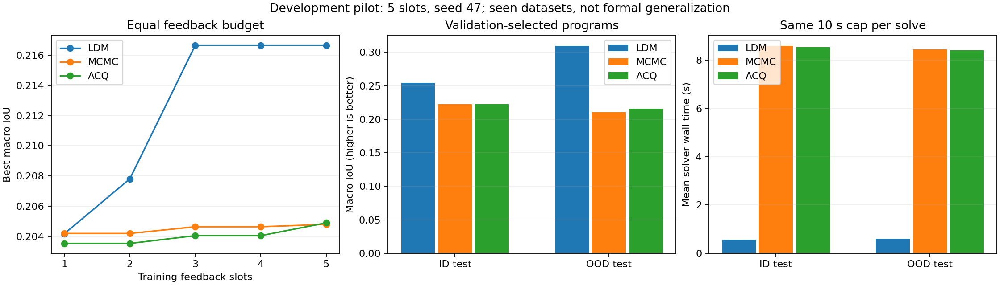

# 铜矿 v2：三方法私有评估开发验收

日期：2026-10-24。运行：`three-method-selection-r1`，H20 服务器。

## 结论与适用范围

融合 LDM、MCMC、ACQ 三组训练、训练封存、验证选型和 ID/OOD 测试全部完成。训练候选、验证候选及最终测试输出全部合法，无失败求解；本次未发现需要修复续跑的异常。私有账户中的完整协议重放返回同一结果，450 份作业及逐 case 收据的修改时间保持不变，没有重做评分。

LDM 在本次开发比较中平均 IoU 更高，最终程序求解明显更快。但绝对 IoU 仍偏低；ID 仅胜出 2/4 个母体，OOD 胜出 3/4 个母体，且 OOD 平均收益主要来自一个母体。不能将结果表述为稳定、普遍或已证明真实地质合理性的优势。

**这些是已见开发数据、旧观测配方、单次算法发现和单个执行种子，不是新的独立正式测试。** 数据母体及真值摘要在本轮训练/验证/测试之间互斥，但开发历史中的可见性不因换账户或重新封存而消除。本轮完成的是私有流程的真实验收与开发比较；新数据配方的科学校准、正式数据资格和三次重复仍未完成。

## 同预算协议

| 项目 | 三方法共同设置 |
|---|---|
| 训练反馈 | 各 5 槽位，每槽评估完整训练套件 |
| 训练数据 | 8 个地质母体 × 2 个观测包 = 16 cases |
| 验证 | 训练封存前 3 个候选，各评估 4 母体 × 2 包 |
| 测试 | 仅验证选中的 1 个程序；ID、OOD 各 4 母体 × 2 包 |
| 每次求解资源 | 10 秒上限、2 CPU、4 GiB；执行 seed=47 |
| 科学实现 | 相同冻结服务源码、Docker 镜像、公开数据、约束、独立 scorer |
| 指标 | 母体宏平均 IoU；报告中的几何损失为 1−IoU |

每方法训练 80 次求解、80 次独立评分；验证 24 次求解及评分；测试 16 次求解及评分。接口检查另计。450 是选型/测试阶段所有 receipt 文件数，包含作业收据与逐 case 收据，不能作为独立样本数。

LDM 使用 AST/Qwen 等权融合、官方 DeepSeek V4.1 Flash/low，初始化后生成 8 个提案选择 4 个。经典基线各使用包含默认配置的 5 个 Sobol 参数配置。公平性指相同科学反馈额度及每求解资源上限，**不表示总计算量、LLM 费用或算法开发成本相同**。MCMC/ACQ 为适配当前公共目标的基线实现，不声称逐行等同论文原始实验。本轮也不是 81 槽位、120 秒或三个种子的正式实验。

## 结果

IoU 越高越好。训练列为训练阶段最佳值；验证及测试列对应验证选中的最终程序，基线的训练第一名不等于验证第一名。

| 方法 | 训练最佳 IoU | 验证 IoU | ID 测试 IoU | OOD 测试 IoU | ID 求解秒/包 | OOD 求解秒/包 |
|---|---:|---:|---:|---:|---:|---:|
| LDM 融合 | 0.21666 | 0.35138 | **0.25444** | **0.30981** | **0.568** | **0.599** |
| MCMC | 0.20480 | 0.31434 | 0.22232 | 0.21048 | 8.602 | 8.452 |
| ACQ | 0.20490 | 0.31514 | 0.22232 | 0.21610 | 8.537 | 8.413 |

| 方法 | ID 几何损失 1−IoU | OOD 几何损失 1−IoU | 测试合法率 | 测试失败 |
|---|---:|---:|---:|---:|
| LDM 融合 | **0.74556** | **0.69019** | 100% | 0/16 |
| MCMC | 0.77768 | 0.78952 | 100% | 0/16 |
| ACQ | 0.77768 | 0.78390 | 100% | 0/16 |

相对 MCMC，LDM 的 ID/OOD IoU 分别增加 0.03213/0.09933，几何损失约降低 4.1%/12.6%；最终求解约快 15.1/14.1 倍。该时间不包含 LDM 算法发现成本，不能表述为端到端同等倍数加速。

训练发现实际历时：LDM 913.58 秒（15.23 分钟）、MCMC 1056.76 秒（17.61 分钟）、ACQ 1054.09 秒（17.57 分钟）。LDM 另有 87 次研究 LLM 请求，控制器 54 个接口作业；基线控制器各 30 个接口作业。私有训练服务各 30 个接口作业。完整账本见原始证据；并行运行期间墙钟受资源调度影响，不据此推算货币成本。

### 跨母体表现不能代替跨种子稳定性

对 MCMC 和 ACQ，LDM 均在 ID 的 2/4 个母体、OOD 的 3/4 个母体胜出。对 MCMC 的 ID 母体 IoU 差值约为 +0.21674、−0.12374、−0.04515、+0.08066；OOD 为 +0.05172、+0.01946、+0.45265、−0.12652。OOD 有一个大收益母体、也有一个明显退步母体。每母体两个观测包先平均，不将相关观测包当作独立地质样本。本轮没有三个种子的方差或置信区间证据。

## 私有账户流程与审计

1. 三组完成全部 5 个训练槽位，服务审计完整训练收据，生成持久训练封存。重复封存保持候选顺序；封存后再申请训练评估被拒绝。
2. 受信账户 `ldm-copper-eval` 将三个方法各自的前 3 个源码及训练来源、数据摘要、科学实现、镜像和预算冻结；所有方法冻结完毕才开始验证。
3. 复用已有 selection 状态机完成验证，按 IoU、合法率、时间和 SHA 的固定规则选出唯一程序。所有方法验证完成后才开始测试，不根据测试结果重新选型。
4. 测试完成后，三个状态均为 `tested`。重新调用验证/测试得到相同结果，450 份收据修改时间不变。逐方法核对 8 个 ID 和 8 个 OOD 求解均成功。

最终源码 SHA256：

| 方法 | 验证选中的 SHA256 |
|---|---|
| LDM | `4a28cadede884f8a4ba2b0588095d7bce6c48a17beb6d152c0867ceefdc7b824` |
| MCMC | `0ab4dab67af2c62667e5cf9faa0939b86ca31a7ce1b9a2777b1afc4e0f191b40` |
| ACQ | `d993ab0afc2cd559f0978bf130ef3046e2862912c46b4505a2e3b0edc51b465d` |

LDM 保留训练第一名；两个基线均由验证选型替换训练第一名。研究控制器只持有公开 catalog；本次验证/测试由私有账户执行，真值不交给候选。该隔离针对研究 guest/候选，不防拥有 sudo 的管理员；评估账户具有 Docker 权限，属于可信计算边界。

## 后续科学门槛

- 完成薄矿体、断层、边界及多尺度观测误差校准，再冻结新科学契约。
- 按正式方案生成新的独立母体与观测，封存生成身份及测试访问；本次开发测试不得再标为未见测试。
- 使用预注册的相同反馈额度、120 秒求解预算及多次发现/执行种子验证均值和稳定性。
- 结合几何诊断与地质审核判断合理性；合法率 100% 仅表示满足当前检查，不能替代科学真实性。

## 可复核证据

- [训练审计](../tasks/copper_inversion/resources/evidence/v2-development/three-method-training-audit-r1.json)
- [训练封存](../tasks/copper_inversion/resources/evidence/v2-development/three-service-training-seals-r1.json)
- [完成结果、重放检查及母体配对结果](../tasks/copper_inversion/resources/evidence/v2-development/three-method-comparison-r1.json)
- [训练历时与逐槽曲线](../tasks/copper_inversion/resources/evidence/v2-development/three-method-discovery-cost-r1.json)

远程完整私有产物：`/Aidata/shared/ldm/copper-v2-evaluator/runs/three-method-selection-r1/`。本地证据仅导出评分和审计摘要，未导出私有真值数组。
