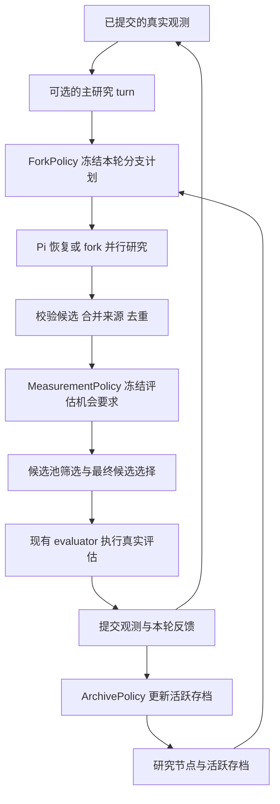

# 基于 Pi 历史的通用研究搜索架构设计

设计状态：待实现。日期：2026 年 10 月 14 日。

把一次研究看作从一个可恢复状态出发、产生一批候选并接收真实反馈的计算。框架负责保存状态、执行、评估、预算和恢复；策略负责决定从哪里继续、哪些候选需要评估、哪些状态继续保留。

推荐沿用现有 LDMEngine 和 Pi Harness，补齐三个决策之间的反馈闭环。保留一个主干是策略配置；四个独立 session、最新主干四 fork、2＋2、JointGain 1＋3都使用同一套执行机制。Token 和费用继续记账，暂不进入策略目标。

最重要的变化是把“有不同的分支”推进为“不同方向得到评估，并有机会继续”。它能减少探索在中途被筛掉的情况；是否提高最终优化效果，需要固定预算的配对实验验证。

## 1 设计边界

第一版支持一轮内分支并发、轮与轮之间同步提交。一个研究节点对应一次被接受的研究 turn 结束后的状态，包含 session 历史、工作目录快照和当时提供过的证据位置。普通消息、工具调用和推理 token 继续由 Pi 管理，不升格为搜索节点。

这个粒度直接对应当前的候选批次、分支提交和评估预算，避免把一长段工具交互展开为难以归因的搜索树。

| 由通用框架负责 | 由任务负责 | 由策略负责 |
| --- | --- | --- |
| 快照、fork、并发、提交、恢复 | 研究提示词、身份和提交格式 | 选择父节点、继续或 fork |
| 候选来源、去重、预算、评估回执 | 候选有效性和 canonical key | 分配有限的评估机会 |
| 观测、使用量、确定性计划 | 目标方向、质量函数、行为描述 | 活跃存档的保留和淘汰 |

第一版不增加另一套 campaign 引擎、工作流 DSL、分布式调度器或通用图数据库。也不引入跨轮异步搜索、自动合并 session、模型自评奖励或独立的价值网络。现有工厂加载方式足以接入自定义 Python 策略。

一次决策的状态可写成 `S_t = (已测事实, 持久 session heads, 活跃存档, 剩余预算)`。一个研究动作是 `(父快照, 研究身份, resume 或 fork)`；动作完成后，策略还要决定如何使用固定的真实评估机会。对提供标量质量的任务，总目标是在固定评估预算内提高最终最好实测质量。

因此，同一个父快照在获得新事实后，继续研究的价值可能改变。旧节点不是具有恒定 Q 值的搜索位置。第一版采用逐轮重新决策，不假设历史回报独立同分布，也不把常规 UCT 的回传与保证直接套在共享观测的研究 session 上。

## 2 当前实现与需要补齐的部分

现有代码已经提供以下基础：

- `ResearchStrategy`、`ForkPolicy`、`ArchivePolicy` 是配置和纯规则入口。
- `ResearchTree` 已经保存父节点、谱系、fork 计划和候选来源，并验证快照身份。
- `LDMEngine` 已经负责候选准入、选择、评估、预算，以及待完成 selection 的恢复。
- Pi Harness 已经能从冻结 session 和工作目录创建分支；研究请求与摘要请求使用分离的参数作用域。

需要解决的具体缺口：

| 当前位置 | 问题 | 设计中的处理 |
| --- | --- | --- |
| `tasks/nucleobench/core/fork_tree.py` | 生命周期逻辑混有 `utility` 和 DNA 描述符 | 通用状态管理移到 harness；质量和描述符留在任务 |
| `ReservoirBuilder.build` | 重复候选被拒绝，保留的候选没有自动合并全部来源 | 合并来源集合，保留原提案频次和拒绝计数 |
| NucleoBench selector | 先缩到 BO 池，再选真实评估候选 | 评估机会要求同时经过两道筛选 |
| `ResearchTree.prepare` | 上一轮反馈主要在下一次 prepare 时回填 | 本轮评估结束就提交反馈，最后一轮也执行 |
| engine selection 恢复 | 恢复已有 selection 时不再调用 expander | 增加显式的轮次 finalizer，正常和恢复路径共用 |

这几项属于实际闭环所需的修改，不需要重写 BO、评估器或 Pi 的消息树实现。

## 3 总体执行结构



`LDMEngine` 继续持有唯一轮次循环。通用 `ResearchExpander` 负责图中的主研究和分支研究；selector 负责两级候选筛选；轮次 finalizer 负责把已提交观测反馈到研究状态。

编译 acquisition 的 policy session 仍属于现有 selector。它与主研究 session、候选生成分支是不同角色，不能因为增加了研究策略而重复执行或漏计消耗。

## 4 研究状态与证据模型

### 4.1 不可变节点

沿用 `ResearchNode`，把不可变状态和可重建统计分开。

| 字段 | 含义 |
| --- | --- |
| `node_id` | 本次已提交研究状态的唯一标识 |
| `parent_id` | 直接继承的研究状态；根节点为空 |
| `lineage_id` | 正在延续的研究谱系 |
| `snapshot` | 现有 Pi session、工作目录和哈希 manifest 引用 |
| `round_index`、`turn_id` | 创建节点的实际研究操作 |
| `history_cursor` | 该 turn 已被提供的观测前缀位置及摘要 |
| `proposal_keys` | 该节点本次新增的候选 canonical keys |

`best_score`、评估数、扩展次数、最近被选择时间属于派生视图。它们由节点、计划、观测和回执计算，可以缓存，但缓存必须携带对应的证据位置，不能成为第二份可独立修改的真相。

节点的 `proposal_keys` 只表示本次提案。整个谱系提出过什么，通过该谱系的节点集合查询，避免继续分支时把继承的旧候选再次当作本次贡献。

### 4.2 节点 谱系与 session 的区别

- 节点表示一个具体的冻结状态。
- 谱系表示连续研究的方向；继续一个存档分支保留谱系 ID。
- Pi session 是执行载体；从快照创建新的 session，也可以在逻辑上延续原谱系。
- 从主干或历史锚点另开方向，创建新谱系；同一父节点生成多个不同子分支时不能共用一个新谱系 ID。

每条谱系每轮最多有一个继续写入者。计划可以从同一个冻结父节点派生多个新谱系，但不能让两个并发进程修改同一 session 或工作目录。

配置要求保持运行的 heads 单独固定：有主研究时固定其 head；独立 session 模式固定各身份的 head。活跃侧枝存档不拥有这些 head 的生命周期，不能因侧枝容量用完而淘汰它们。root、head、选中的历史锚点、活跃侧枝共同组成当轮有限的可选集合。

### 4.3 单独保存来源关系

复用现有 `RawProposal`、`Candidate`、`Observation`。在候选准入结果中增加有类型的来源记录，至少包含 `turn_id`、`node_id`、`lineage_id`、`profile_id` 和该来源的提案次数。

同一个候选由 A 和 B 两个分支提出时：

1. canonical key 只对应一个待评估候选。
2. 来源保存为 `{A, B}`，原始提案频次仍然保留。
3. 真实评估只占一个位置，结果可供两个分支使用。
4. 全局收益只计算一次；不把这个结果当作两个独立统计样本。

已测过的候选再次出现，记为已知结果的再次发现。它能帮助解释分支收敛，却不能增加新评估数、新证据数或本轮优化收益。

来源合并不改变当前 empirical q0 的定义。提案次数、不同来源数、唯一候选数是三种不同统计量。

候选准入顺序按已冻结的 slot 顺序和分支内提案顺序排列。同一 canonical key 使用该稳定顺序下的代表 candidate ID，其余 ID 归并到它；不能让最快完成的分支决定去重结果。

### 4.4 共享事实 保留分支研究历史

每轮冻结一个全局证据前缀。所有同轮分支使用相同截止位置；旧节点只补充它尚未收到的观测增量，并保留完整事实文件的读取入口。

恢复历史节点时加载：

```text
该节点自己的 session 和工作目录
+ 本轮冻结的新增真实观测
+ 当前任务约束与分支身份
```

不自动把最新主干的研究结论、首选假设或整段摘要注入历史侧枝。主研究可以读取分支提交的结构化反馈，但全局事实文件应把已测结果、预测和研究假设分开。

`history_cursor` 表示框架已经提供过哪些事实，不宣称模型已经理解或记住了它们。压缩失败不能推进 cursor。

## 5 策略接口

保持三个实际需要的决策入口。以下是目标接口草案，字段名在实现时与现有类型统一；不增加另一层策略注册机制。

```python
@dataclass(frozen=True)
class ResearchStrategy:
    coordinator_profile: str | None
    fork_policy: ForkPolicy
    archive_policy: ArchivePolicy
    measurement_policy: MeasurementPolicy | None = None

class ForkPolicy(Protocol):
    def identity(self) -> dict: ...
    def plan(self, context: ForkContext) -> tuple[ForkAssignment, ...]: ...

class MeasurementPolicy(Protocol):
    def identity(self) -> dict: ...
    def plan(self, context: MeasurementContext) -> SelectionRequirements: ...

class ArchivePolicy(Protocol):
    def identity(self) -> dict: ...
    def retain(self, context: ArchiveContext) -> tuple[str, ...]: ...
```

`ForkAssignment` 在现有字段上增加 `mode = "resume" | "fork"`。`resume` 继续指定谱系的当前持久 session；`fork` 从不可变父快照创建独立工作目录。现有 `profile_id`、`parent_id`、`lineage_id` 保留，`purpose` 用于解释决策，不作为隐藏的执行开关。

初始化时由框架创建配置要求的根 session 和根快照，不需要额外模型调用。四个独立 session 的策略从各自根节点开始 resume；主干策略先运行 coordinator，再从最新主干或其他已提交节点 fork。

`coordinator_profile` 是否存在不再由 `fork_policy is not None` 间接决定。这样，是否保留主干和如何选择侧枝成为明确的两个配置项。

### 5.1 三个 context 的内容

| Context | 输入 | 禁止依赖 |
| --- | --- | --- |
| `ForkContext` | 轮次、证据位置、可选节点、谱系统计、身份列表、剩余固定预算、种子 | 本轮尚未生成的候选和未来评估结果 |
| `MeasurementContext` | 已准入候选及来源、任务分组、已有观测、池容量、主选数量和尝试上限 | 再次调用模型或 evaluator 来决定分组 |
| `ArchiveContext` | 已提交节点、本轮真实反馈、原活跃存档、容量、任务描述符 | 用未测试候选的预测值冒充实测质量 |

规则必须是纯函数，返回值必须能序列化。输入、策略语义版本、参数和随机种子写入计划。随机性按 `run seed / round / phase / slot` 派生，不能受并发完成顺序影响。

框架校验父节点存在、快照身份正确、profile 数量和预算一致、谱系无并发冲突。策略不能直接执行 LLM、修改预算、写 session 或解除 failure。

### 5.2 任务提供的信号

候选准入仍通过 `CandidateDomainAdapter`；特征编码仍通过现有 `SurrogateEncoder`。任务额外提供所选策略实际需要的纯函数：

- `quality(observation)`：显式的越大越好标量，或者不提供。最小化目标的转换和多目标标量化由任务定义，原始目标始终保留。
- `descriptor(candidate)` 或 `region(candidate, context)`：表示行为或候选结构的差异，而不是 session 身份差异。
- 现有的研究 turn 构造和提交校验函数。

普通 fork 策略不要求 descriptor。选择需要行为分区的策略而任务未提供分区能力时，preflight 报错；不能悄悄使用文本相似度或随机分区替代。

Pi 的 fork 是消息历史能力，工作目录恢复是 Harness 的能力。第一版只使用已经接入的 Pi 后端，不为尚未接入的后端设计新插件层。

## 6 真实反馈如何参与决策

每次研究扩展保留以下可区分的数量：

```text
raw_proposed → valid_unique → new_unique → pooled
             → selected → attempted → successful → improved
```

这些数量回答不同问题。没有得到评估机会，不能记成“研究方向失败”；provider 超时也不能记成科学质量为零。

设一次扩展 e 的新候选中，实际成功评估的集合为 T_e。冻结扩展前的全局最好质量 b_global，以及该谱系此前的最好实测质量 b_lineage。

当 T_e 非空时，可以计算：

```text
best_e       = max quality(x), x in T_e
global_gain  = max(0, best_e - b_global)
local_gain   = max(0, best_e - b_lineage)
```

没有谱系历史时 `local_gain` 未定义；没有成功评估时 `best_e` 和两种 gain 都是未知值。它们不能用 0 填充。任务没有质量标量时，保留原始目标和状态，禁用要求标量的策略。

全局 gain 衡量这次实验对当前最好结果的贡献；局部 gain 衡量某个方向是否仍在进步。局部进步可以支持继续探索，但不授予无限延续权：下一轮仍受相同分支数、档案容量和评估预算约束。

同一个候选有多个来源时，各来源都能读取它的结果，但反馈保留共享的 `evaluation_id`。核心不自动生成各得一份奖励的独立样本，也不把子节点最好分数沿全部祖先做无条件回传。需要信用分配的策略必须显式定义其估计方法，并承认共享证据的相关性。

奖励和统计均使用做决策时冻结的基线。之后全局最好结果提高，不回头改写旧决策的输入。

## 7 让评估机会真正通过筛选

### 7.1 要求的表达

保留现有 acquisition 和 q0。新增的接口只表达有限的保留要求：

```python
@dataclass(frozen=True)
class EvaluationGroup:
    group_id: str
    candidate_ids: tuple[str, ...]
    min_pool: int
    min_attempts: int

@dataclass(frozen=True)
class SelectionRequirements:
    groups: tuple[EvaluationGroup, ...] = ()
    partition_identity: str = ""
```

groups 的顺序表示确定的处理优先级。第一版要求候选组互斥：一个 candidate ID 至多属于一个有保留要求的组。语义上的多个来源仍保留；分配机会时只能占一个组，策略须在返回计划前确定归属。框架拒绝重叠组，不引入通用约束求解器。

组外候选以及组内未被保留的候选，都可以参与剩余位置的全局竞争。分组依据及其版本、参考候选哈希一并冻结；历史图表不能把不同分组版本当作同一统计口径。

### 7.2 两道筛选使用同一份要求

对当前 NucleoBench，原始上限为 128、BO 池上限为 64、主评估批次为 16。这些是任务配置，不写入通用协议。

1. 先对完整的有界提案批次做准入和来源合并。
2. `MeasurementPolicy` 在去重后的候选上产生要求并持久化。
3. 建 BO 池时，按原有 q0 对各组选择 `min_pool` 个候选；剩余池位置仍按原有 q0 选择。
4. 在这一个 BO 池上运行现有 surrogate 和 compiled policy 流程。
5. 选最终评估候选时，按现有 acquisition 权重在各组选择 `min_attempts` 个候选；剩余位置仍使用全局选择规则。
6. 保留候选排在实际 dispatch 队列前部，随后是普通主选和原预算允许的备用候选。

两级都使用现有无放回采样实现。一个阶段先生成每个候选的随机优先值，组内保留和剩余全局选择复用该阶段的优先值，不为每个组重复调用完整 selector。空要求时，候选顺序、种子和选择结果必须与原配置一致。

第 3 步不提前按 UCB 筛选，以免为了构造 BO 池重复执行 compiled policy。组的选择依据已有事实和任务描述，组内候选在最终阶段才使用本轮 acquisition。

### 7.3 边界处理

- 要求满足 `min_pool >= min_attempts >= 0`，总保留数不超过对应阶段的实际预算；错误的配置在执行前拒绝。
- 某组合法候选不足时，将该组保留数缩到可用数量，释放的位置进入全局竞争，并记录 shortage 原因。
- 候选重复、无效、已评估都不能用于填充保留数。
- `min_attempts` 保证的是正常执行到该阶段时的尝试机会，不保证成功返回科学结果。失败仍计入尝试预算。
- 失败替补仍由现有 `replace_failed_evaluations` 和 attempts 上限控制。不能为了满足“成功反馈数”额外增开调用。
- 第一版的准入容量须容纳该轮全部允许的原始提案。因此要求不会先被一个隐藏的 reservoir 容量截断破坏；不满足此条件的配置在 preflight 拒绝。
- selector 必须显式声明并实现要求支持。其他任务的 selector 不支持时不能静默忽略。

### 7.4 一个具体例子

一轮有四个分支。A 从最新主干生成局部优化候选；B、C、D 分别从历史节点或存档方向继续。准入后，任务把候选分成当前最好区域和三个不同的探索区域。

探索区域各获得 4 个池位置和 1 个评估位置，则：

```text
BO 池 64 = 探索区域保留 12 + 全局竞争 52
主评估 16 = 探索区域保留 3 + 全局竞争 13
```

这不等于每个分支固定测一个。若 B 和 C 实际提出同一区域的相似候选，它们共享该区域的机会；若 D 提出了多个真正不同的区域，策略可以选择其中多个区域。目的在于覆盖候选行为，而不是凑齐身份标签。

如果只存在一个探索区域，则只保留该区域的 4 个池位置和 1 个评估位置，其他位置回归全局竞争。全程没有增加池大小、候选生成量或 evaluator 调用预算。

## 8 活跃存档与多步探索

永久历史和活跃存档是两个概念。永久历史记录所有已提交节点；活跃存档是下一轮愿意分配计算的少量节点引用。剪枝只移出活跃集合，不删除 session、候选、观测或消耗证据。

`ArchivePolicy` 接收以下不同状态：

| 状态 | 解释 | 可采取的动作 |
| --- | --- | --- |
| 待检验 | 有新合法提案，但缺少实际成功评估 | 有界保留试验机会，或明确记录未获机会而移出 |
| 有局部进展 | 当前方向有真实改善 | 与其他方向竞争继续名额 |
| 已测试无进展 | 已有可用反馈，但没有达到策略的改善标准 | 降低优先级或移出 |
| 执行受阻 | 模型、工具或外部评估失败 | 按恢复规则处理，不伪造负科学反馈 |

一个可选的分区精英存档规则是：按任务定义的区域保留实测代表，同时允许少量待检验节点进入试验期。区域内以实际质量比较；区域之间优先保留不同的行为，而不是只取全局最高的若干节点。这借鉴了 [MAP-Elites 的分区精英思想](https://arxiv.org/abs/1504.04909)，保存对象在这里是可继续研究的状态。

试验期必须双重有界：最多允许配置数量的实际扩展机会，也有轮次到期位置。没有被评估不等于质量差，但不能让一个长期得不到证据的节点永远占位。到期移出时记录 `unresolved`，不记作零收益。

策略根据反馈保留侧枝，并在后续轮次再次 fork 其最新已提交节点，就形成多步探索。框架不要求一次未超过全局最好就立即剪掉，也不强制所有侧枝下一轮重新从主干出发。

档案收紧容量时，由策略在容量内选择：先保证其配置承诺的待检验机会，再保留不同区域的实测代表，最后处理剩余位置。待检验容量、机会次数和到期轮次都必须在配置中明确；不得用“尚未测到”无限推迟淘汰。第一版核心只校验容量和节点身份，具体排序仍属于 `ArchivePolicy`。

历史主干锚点和侧枝存档都必须有明确的可选数量上限及产生规则。完整节点索引可用于审计，但不默认让每轮策略扫描全部旧状态。老方法原有的锚点和档案容量在原配置中保持原值。

## 9 首个可选策略的具体组合

建议第一项新策略先复用现有 JointGain 1＋3 的选点规则，增加评估覆盖；不要同时更换选点估计器、存档规则和 acquisition。这样可以判断收益究竟来自哪里。

1＋3表示四个候选生成分支的构成。coordinator 仍单独运行，compiled policy session 也仍存在；二者的调用预算和消耗不能隐入这四个分支而漏算。

| 参数或步骤 | 第一个新配置 |
| --- | --- |
| 主干 | 保留现有 coordinator；固定 1 个最新主干分支 |
| 其他 3 个分支 | 继续使用冻结版 JointGain v2 的联合选点，不固定重启或延续配额 |
| 活跃存档 | 首次消融保持该 JointGain 配置的现有容量与保留规则 |
| 评估区域 | 任务提供有版本的互斥分区；区别于分支身份 |
| 保留区域数 | 最多 3 个当前存在的非主区域 |
| 选择区域 | 先按截至上轮成功评估数升序，再按最近获机会轮次、group ID 打破平局 |
| 每区域保留 | 池中最多 4 个，主批次中 1 次评估机会；候选不足时按第 7 节处理 |
| 剩余位置 | 原 q0 与 acquisition 规则 |
| 预算 | 轮数、4×32 提案、64 池、16 主评估及原失败替补上限均不变 |
| 消耗 | 记录全部 token 和费用，不参与选点与奖励 |

这里“非主区域”由任务分区对当前最好候选的归属决定。任务未能提供稳定且有科学意义的分区，就不能启用这个配置。NucleoBench 的序列距离或组合特征可作为候选描述，但具体阈值需要预先固定；已有图表中的诊断阈值不能直接视为已经验证的策略参数。

这个组合是完整可执行的策略合同，不宣称最优。第二项独立消融才替换为分区存档和有界试验期；第三项才修改 JointGain 的估计或用其他调度规则。全部复用同一份状态、来源和反馈协议。

从历史父节点恢复再探索，借鉴 [Go-Explore](https://arxiv.org/abs/2004.12919) 的状态保存与返回机制。把多个可继续的研究方向视为计算分配对象，与 [Multi-Emitter MAP-Elites](https://arxiv.org/abs/2007.05352) 的发射器选择、[TuRBO](https://arxiv.org/abs/1910.01739) 的局部搜索预算分配有相近动机。这些论文支持机制选择，不构成该组合在 LLM 科学搜索中一定更好的证明。

## 10 一轮的完整生命周期

```text
ROUND_OPEN
  → COORDINATOR_COMMITTED       可选
  → FORK_PLAN_COMMITTED
  → BRANCHES_COMMITTED
  → SELECTION_COMMITTED
  → EVALUATIONS_RECORDED
  → RESEARCH_FEEDBACK_COMMITTED
  → ROUND_COMMITTED
```

1. 读取引擎 checkpoint 和已提交观测，冻结本轮事实位置、预算和实现身份。
2. 如果配置主研究，先冻结其请求身份，执行并提交主研究 turn 与快照。恢复时复用已有提交。
3. 用最新主研究节点及其他可选状态调用 `ForkPolicy`，验证并提交分支计划。计划存在时不得重新抽样。
4. 并发恢复或 fork 各分支。每个分支分别保存请求、使用量、提交和快照；顺序由计划决定，而非完成时间。
5. 全部所需分支成功提交后，准入完整候选批次，合并来源，生成并冻结评估要求。
6. selector 运行一次现有完整选择流程，返回候选池、预测、最终主选和可用备用序列；引擎持久化待执行 selection。
7. 由现有 evaluator 回执和预算机制执行，提交每个结果。
8. 调用研究轮次 finalizer，按本轮结果生成反馈、选择活跃存档，原子提交研究状态。
9. 引擎推进 `next_round`、写 checkpoint，并清除已经完成的 pending selection。

轮次 finalizer 必须覆盖正常完成、从 selection 恢复、候选为空、以及最后一轮。初始化轮只建立初始证据基线，没有候选分支计划，也不会伪造一次研究扩展。

若 finalizer 失败，checkpoint 仍停在本轮。重启只重做基于已存结果的 finalization，不重新生成候选或调用 evaluator。

### 一次第十二轮的例子

开始时已有 177 条成功观测。主研究提交 `main_12`；计划选择 `main_12`、历史主干 `main_4` 和两个侧枝最新节点。其中历史重启建立新谱系，两个侧枝继续原谱系，均获得相同的 177 条事实前缀。

四个分支提交 128 条提案，准入、去重和已测排除后剩下 112 个。评估规则选择三个非主区域，各保留 4 个池位置和 1 个主评估位置；所有候选合计仍只进入一个 64 大小的池，最终执行 16 个主评估。

若全部成功，观测增长到 193 条。某侧枝把自己的最好质量从 5300 提高到 5700，而全局最好为 8200，则其局部 gain 为 400、全局 gain 为 0。反馈同时保留这两个值。启用试验期存档的配置可以让它继续，是否保留由该配置的容量与排序决定。

若第 16 个结果已落盘、进程在观测提交前退出，恢复后补交该结果并完成档案更新，仍为 193 条观测；不会重新生成四个分支，也不会再执行第 16 个候选。

## 11 提交 恢复与身份

### 11.1 复用现有持久化机制

继续使用 CampaignRuntime 的 events、budget、checkpoint，以及 Harness 的 turn receipt 和 provider traces。研究模块只增加节点索引、计划、来源和反馈文件，不复制一套观测库、计费库或事件系统。

建议文件布局如下，其中 `refs` 为现有文件引用和哈希：

```text
campaign/
  checkpoints/                       现有引擎 checkpoint
  events... budget... observations... 现有记录
  research/
    nodes/<node_id>/manifest.json     不可变快照身份及来源
    rounds/<round>/fork-plan.json
    rounds/<round>/proposal-origins.json
    rounds/<round>/selection-requirements.json
    rounds/<round>/feedback.json
    rounds/<round>/commit.json        最后原子写入，引用上述哈希
```

不依赖不同文件同时原子更新。先写内容文件，再原子写 commit；checkpoint 只引用已验证的 commit。崩溃后，未被 commit 引用的暂存文件不能被当作完成状态；已经提交的节点和分支收据可以被复用。

轮次 commit 只保存稳定事实和引用，不把每次重试时变化的时间戳加入内容身份。计时信息留在事件中，保证同一批输入重复 finalization 得到相同结果。

### 11.2 每种中断的行为

| 中断位置 | 恢复动作 |
| --- | --- |
| fork 计划尚未提交 | 从同一已提交主研究状态和证据前缀重新计算纯计划 |
| 部分分支已提交 | 校验并复用提交；只处理未提交分支，遵循已有 failure 和尝试上限 |
| selection 已提交 | 使用原候选、顺序、约束、随机结果，不再执行 expander 或 selector |
| evaluator 结果已保存但观测未写完 | 根据原回执补交观测，不再次调用 evaluator |
| evaluator 已发出但返回状态未知 | 通过任务适配器的持久回执查询；无法确定时停止等待处理 |
| 研究反馈已提交但引擎未推进 | 校验原 commit 后推进 checkpoint，不重复记贡献 |

本地提交可以做到幂等；外部 API 的恰好一次执行取决于 evaluator/provider 的回执能力。仅凭本地事件 ID 不能承诺外部只收费一次。无法确定已发出的请求是否完成时，禁止自动当作未执行而重发。

模型输出耗尽、摘要失败、身份不符和工具执行失败，各自保留错误类型。恢复机制不能自动把它们转换成更多尝试、降低研究推理等级或扩充输出预算。

### 11.3 冻结什么

每个运行与计划保留源码/构建哈希、镜像身份、模型参数、提示词/任务合同、策略 identity、父快照哈希、证据前缀、预算和随机种子。

策略变化意味着新科学配置；实现修复意味着显式的新部署记录。两者都不能静默覆盖原 provenance。历史运行继续用冻结版本读取；不为新状态模型增加隐式迁移、旧接口 wrapper 或恢复 fallback。

Pi session 快照不等于完整进程快照。运行中的子进程、外部服务状态、环境安装和远程副作用不随 fork 自动回滚。提交前必须结束该 turn 的受管工具调用；任务的外部评估通过独立回执追踪。

### 11.4 消耗记账

每次实际 provider 尝试都有唯一调用身份，并关联主研究、候选分支、compiled policy、摘要或恢复操作。记录输入、缓存命中输入、输出及可用的 reasoning 明细；reasoning 若已包含于输出，不能再加一次。

快照中复制的历史 trace 不是新调用。恢复前备份、fork 继承历史、共享候选的多个来源都不能重复收费。缓存命中输入是总输入的一部分，不可同时按未缓存输入全额计价。

所有失败调用和修复摘要仍计入运行总消耗。价格表作为有版本的分析参数独立保存，不反向影响研究决策。

## 12 四种已有方法如何接入

| 方法 | Coordinator | ForkPolicy 的计划 | MeasurementPolicy |
| --- | --- | --- | --- |
| 旧 LDM 四独立 session | 无 | 四个持久谱系各自 resume 当前 head | 空 |
| 主 session 加四 fork | 有 | 四个新谱系 fork 最新主干 | 空 |
| 2＋2 | 有 | 两个最新主干、一个历史锚点、一个存档继续 | 空 |
| JointGain 1＋3 | 有 | 一个最新主干、其余三个联合选择 | 空 |
| 新的评估覆盖配置 | 有 | 与 JointGain 1＋3 相同 | 有界分区保留 |

旧的四种行为是仍需支持的实验配置，不是保留四份执行实现的理由。它们共享恢复、来源、计费和提交逻辑。升级接口时一次性修改在库调用方和配置，删除已被替代的 task 内执行路径；不增加 API 兼容分支。

历史复现实验的 frozen source 不受新代码删除影响。需要比较旧结果时读取历史产物，不能用当前配置名字推断历史版本。

## 13 代码落点

| 位置 | 具体修改 |
| --- | --- |
| `ldm_tts/harness/research_strategy.py` | 明确 coordinator，组合三个策略，沿用当前工厂加载 |
| `ldm_tts/harness/research_tree.py` | 节点、谱系、计划、反馈及纯 context；区分不可变状态和派生统计 |
| `ldm_tts/harness/research_runtime.py` | 从 task 抽出通用快照、分支执行协调和轮次提交；一个模块起步 |
| `ldm_tts/contracts/candidate.py` | 在 canonical 去重时合并有类型的来源，保持原准入和频次语义 |
| `ldm_tts/optimization/records.py` | 加入选择要求；selector 接受显式的可选 requirements |
| `ldm_tts/campaign.py` | recipe 增加可选 `round_finalizer` 回调；不要求所有 expander 实现空方法 |
| `ldm_tts/engine/runtime.py` | 在正常、恢复、空候选路径统一调用 finalizer，再推进轮次 |
| `tasks/nucleobench/core/selection.py` | 在池选择和最终选择中实施要求，复用原采样方法和 compiled policy |
| `tasks/nucleobench/core/forked_harness.py`、`fork_tree.py` | 通用职责移出后删除替代路径；只保留必要的任务组装与信号函数 |
| `harnesses/pi/src/session.ts`、`history.ts` | 复用现有快照和历史机制；保持摘要 low、研究原配置及严格 length-stop |

`round_finalizer` 接收轮次、当前已提交观测、selection 回执和证据位置，由研究模块自行定位该轮计划；通用 engine 不需要理解 DNA、谱系评分或档案选择。finalizer 的实现须用输入哈希保证幂等。

`ldm_tts/optimization/search` 现有的候选状态遍历接口与研究 session 生命周期粒度不同，不强行合并两者。

开发基线必须先核对：本地工作树的 `joint_gain.py` 与最新实验冻结的 JointGain v2 曾存在版本差异。接入已有策略时以各实验 source manifest 为依据，明确选择版本，不直接把本地文件视作已经验证过的 1＋3 实现。

## 14 分阶段交付与验证

### 阶段一 打通统一执行与反馈

统一节点、来源和轮次 finalizer，把通用生命周期移出 NucleoBench。四种已有方法保持原选点和 selector 行为，评估要求为空。

新增的细粒度反馈先用于记录，旧策略继续使用各自既定的排序和评分公式。不能借通用化同时重定义 JointGain 的奖励或 DiverseArchive 的保留规则。

完成标准：相同录制输入下，父节点选择、提案频次、候选选择和预算不变；恢复不重复执行已提交工作；最后一轮也有完整反馈。新增一个无 DNA、无 `utility` 字段的轻量任务 fixture 验证任务边界，不需要启动新的科学实验。

### 阶段二 接通评估机会

加入互斥候选组要求，让同一份要求通过 BO 池和最终评估，并接入第 9 节的可选配置。没有启用要求的运行走同一实现中的空约束逻辑。

完成标准：在 128→64→16 的录制候选案例中，保留要求能到达实际 dispatch；数量、频次和预算没有膨胀；空组、重复候选、候选不足及失败替补均有明确记录。

### 阶段三 独立验证存档和多步探索

接入分区存档与有界试验期，验证连续两个研究步骤可以保留同一谱系，且中途没有超过全局最好不会被框架强制淘汰。移出档案后，完整历史和费用证据仍可追踪。

真实实验先做最小配对消融：原 JointGain、仅评估覆盖、再加存档变化。用相同种子、相同初始观测、相同预算和相同修复后的运行环境。旧 LDM、4fork、2＋2作为已经存在的参照；若它们的运行合同不同，明确列出差异，不能把历史横向比较当作干净的因果消融。

本设计不启动这些实验。

### 必须保留的核心验证

1. 跨分支同一候选只评估一次，来源不丢；q0 不因来源合并改变。
2. 无成功评估、实际零改进、模型失败三者不能混淆；共享结果不增加独立样本数。
3. 评估要求穿过两级筛选，分组重叠和越预算要求被拒绝。
4. 在分支提交、selection 提交、结果落盘和 finalizer 后注入中断，恢复不重跑已完成步骤。
5. 最后一轮与空候选轮仍完成必要反馈；计划恢复不受并发完成次序影响。
6. 源码、策略或快照身份不符时停止；保留现有真实代理路径的摘要参数回归测试。

测试、故障注入和后续实验均在远程 `/mnt/data1/` 下执行。本地用于源代码和设计文档编辑。

## 15 效果如何判断

框架的验收重点是探索是否真的得到资源、反馈是否可靠、历史是否可恢复。算法的验收另看固定预算下的质量。

| 维度 | 需要的图或指标 | 可以回答的问题 |
| --- | --- | --- |
| 优化效果 | best-so-far 对真实评估数，逐种子曲线及配对差值 | 同样评估机会下是否提高质量 |
| 探索漏斗 | 各区域的 proposed、pool、attempted、successful 数量 | 探索究竟在哪一层消失 |
| 多样性 | 候选与已评估集合分别计算距离和区域覆盖 | 提案多样性是否进入实际实验 |
| 持续探索 | 谱系寿命、连续扩展数、获得机会后的局部进展 | 侧枝是否有时间形成成果 |
| 停滞与突破 | 固定窗口无改善长度、突破来源及其与旧最好区域的距离 | 是否出现从其他区域带来的真实改善 |
| 决策校准 | 计划时分数与之后真实反馈，明确样本是否被评估 | 排序是否具有预测力 |
| 效率 | 所有调用的 token、缓存命中费用、墙钟时间 | 机制的额外开销是否抵消收益 |

三种子结果可以判断这批运行的趋势，不能证明普遍优越。仅凭更分散的树形、候选距离增大或停滞减少，均不能证明避免了局部最优。需要看到其他区域被实际测试、继续发展，并对最终质量带来可重复的贡献。

离线数据可以核验计划、选择漏斗和已测样本上的预测关系，不能恢复未测试候选的真实效果。被 selector 选中的样本存在选择偏差；对另一个选点策略的最终收益，仍需要新的配对实验，不能把回放评分当作已验证的反事实结果。

这套设计提供的是一条可审计的链条：保存不同研究状态，分配继续计算和真实评估的机会，再用实际结果修正下一轮决策。
